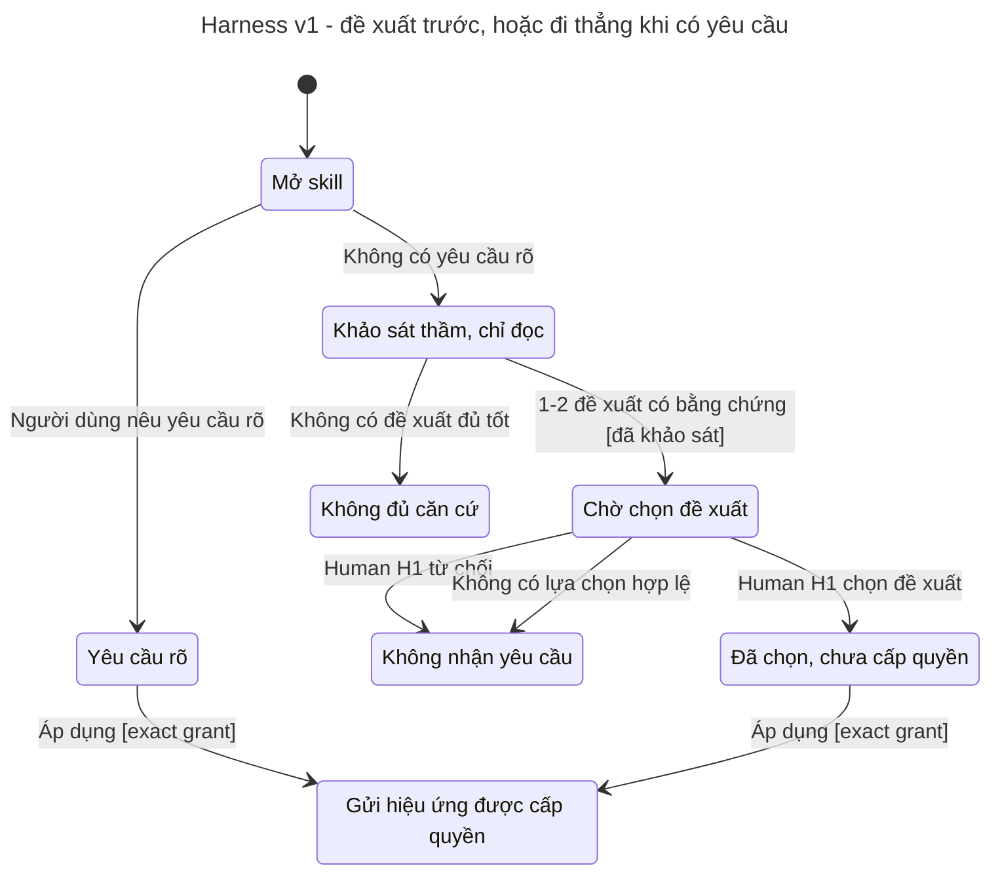
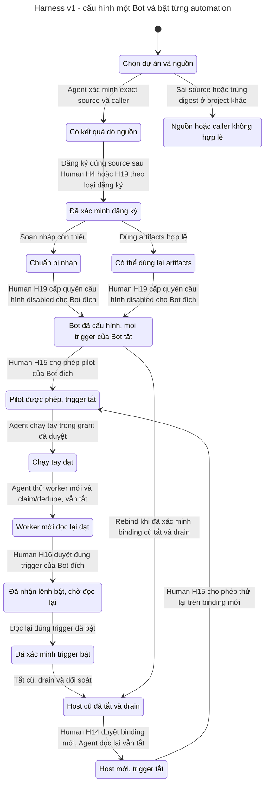

# Harness v1 · Kiến trúc arc42

<a id="arc-1"></a>

## 1. Giới thiệu và mục tiêu

**Mục tiêu:** dựng, cải tiến và vận hành nền Harness bằng một luồng thống nhất. Người dùng chốt ý định, trao đúng quyền và quyết định lần bật thật; agent đọc, soạn, kiểm và tiếp tục trong quyền đã giao. Một Harness có thể cấu hình nhiều Bot độc lập. Chỉ automation được cấu hình mới đánh thức Bot chạy nền. Đây là bản thiết kế để chủ duyệt, **không** cấp quyền sửa repo, merge, cài upstream hay bật Bot. Baseline: [main a782f24][main]; [B7a #100][b7a] là nhánh adapter trong baseline kế hoạch. Bản này không thêm bằng chứng native hay chạy lại TLC.

Bộ này là nguồn thiết kế v1. **arc42** sở hữu biên, [danh mục skill](#skill-inventory) và [cổng Human](#human-gates); [ADR](adr-harness-v1.md) giải thích các quyết định; [RFC kỹ thuật](rfc-harness-v1-detail.md) sở hữu hợp đồng kỹ thuật và thứ tự PR; [Bằng chứng và giới hạn](#arc-10) sở hữu bằng chứng và giới hạn. Những ID trong tài liệu tham chiếu bản ghi gốc, không tạo kho sự thật thứ hai.

| Bên liên quan | Điều họ cần xác nhận |
| --- | --- |
| Chủ Harness | Ý định, phạm vi, quyền, thiết kế đúng revision và điều kiện bật thật. |
| Agent và operator | Route đã bind và quyền cụ thể. Nếu bị chặn, bàn giao đúng ref và bước tiếp theo. |
| Người nghiệm thu | Bằng chứng mở được tại đích. Phân biệt đã áp dụng, đã kiểm, đang bật và đã đo. |

<a id="arc-2"></a>

## 2. Ràng buộc kiến trúc

Giữ nguyên sáu envelope v1 và checker. Thiết kế không bổ sung daemon, scheduler, tracker, store hay entry Bot độc lập. Cài, ghi, publish, execute, close và bật trigger là các hiệu ứng có quyền riêng. Không dùng Sandbox, Inbox hoặc kết quả parse làm quyền tại đích. [Schema và biên kiểm tra](rfc-harness-v1-detail.md#c-envelope) liệt kê các ràng buộc cho producer và consumer.

### Profile đích và mode vận hành

| Profile | Binding, hiệu ứng và mặc định |
| --- | --- |
| `repo-only` | Có repo, không Bot. Mặc định `interactive` nếu yêu cầu nói về repo; không hỏi Bot, không nạp Inbox/Memory, không đòi thêm grant hoặc ghi store chỉ vì chọn profile. |
| `bot-only` | Chọn ít nhất một Bot đích, với workspace và owner thật cho từng Bot. Không dựng repo hoặc Product tracker giả. Phiên `interactive` có thể chuẩn bị; mỗi Bot chỉ có capability bền sau khi đủ binding. |
| `repo-and-bot` | Một đích Repo và ít nhất một Bot đích. Mỗi đích giữ binding, grant, revision và receipt riêng. Chỉ nhánh phụ thuộc phải chờ; từ chối một đích không rollback đích khác. |

`interactive`: phiên hiện tại, không yêu cầu instance/checkpoint bền và không được suy ra wake. `persistent-bot`: instance, adapter và checkpoint đã bind; cấu hình có thể tồn tại khi mọi trigger tắt. Mode không cấp quyền và không làm giả đích Bot. “Đã cấu hình”, “đã chạy tay”, “worker mới tiếp tục được” và “trigger active” là bốn quan sát khác nhau.

<a id="arc-3"></a>

## 3. Ngữ cảnh và phạm vi

| Phần | Trong v1 | Không thuộc v1 |
| --- | --- | --- |
| Nền repo | Bootstrap checkout sạch; AGENTS.md, standards và kiến thức; skills, CLI/MCP, hooks, workflows, model profiles/roles, automations/factory, context isolation và autonomy. Nền là đầu vào để Evolve, không cài mọi capability. | Wizard Bot riêng, daemon/scheduler/tracker/kho mới; cài toàn cục mặc định; bắt mọi repo dùng một stack. |
| Vòng đời | **Setup** nếu chưa có nền; **Evolve** nếu cần đọc hoặc đổi nền hiện có; **Implement** thực thi thay đổi Harness đã chốt; dùng nguyên thì đi route nhiệm vụ hiện có. | Setup không dùng lịch sử runtime. Evolve không chạy lại Setup, không tự bootstrap. Advice không tự mở ticket hay “sửa tiện”. |
| Biên công việc | Harness tracker có instance/namespace/role/quyền xác minh riêng; Product tracker tách thật; có thể cùng provider nếu cách ly thực, không phải hai filter trên cùng issue set. Small-work dùng bản ghi Harness cục bộ bền và được chọn rõ. | Không publish Product qua Harness; không lấy Product, Inbox, board điều phối hoặc local record ngẫu nhiên làm fallback. Link Product chỉ là ref đọc, không sửa tracker kia. |
| Biên quyền | Host kiểm load/caller/ACL, đích kiểm effect/grant/revision; readback và nghiệm thu tách. Repo và Bot không có giao dịch chung. | Không suy quyền từ tên skill, hình dạng JSON, thẻ Inbox, prompt role, quyền sandbox, grant tại hệ khác hay im lặng. |
| Wake của Bot | Một automation được duyệt ánh xạ đến đúng một `target_bot_id`. Bot đích claim occurrence và khóa dedupe trước ACK. | Không định tuyến hội thoại, không chọn Bot bằng role, nội dung hay @mention, không gửi Bot-to-Bot để đánh thức và không phân quyền hay tranh claim trên một luồng chat. |

Người dùng làm việc với entry skill, không cấp quyền qua tên skill. Skill gọi adapter trong scope. Adapter mở ref và kiểm caller tại host. Đích nghiệp vụ thực thi grant, quyền sửa và revision. Repo, tracker Harness, tracker Product, Kit, Library, Inbox, Memory, secret store và wake runner giữ bản gốc của phần mình. Xem [bảng chủ sở hữu](#arc-8) để phân biệt quyền ghi với quyền đọc.

<a id="arc-4"></a>

## 4. Chiến lược giải pháp

**Phương án kiến trúc.** Một cặp Setup/Evolve theo mode, mỗi đích ghi chính mình; adapter chỉ resolve, gọi và đọc lại. Không tạo wizard theo đích hoặc entry `harness-bot-setup`. [ADR-015](adr-harness-v1.md#adr-015) chốt `bots[]` là danh sách các Bot độc lập. Mỗi Bot có `bot_id`, `role`, `contract`, `binding`, `bot-inbox`, `bot-memory`, `grant`, `revision` và `receipt` riêng. Chỉ dùng chung kho `harness-library`; mỗi Bot vẫn resolve selection và quyền theo scope riêng. Ref, revision/epoch và evidence không trao quyền ghi.

Dùng một đường quyết định và triển khai cho ba profile, nhưng resolve và kiểm riêng mỗi đích. Ưu tiên đọc lại dữ liệu canonical. Nếu không chứng minh được quyền, receipt hay fence bắt buộc, không áp dụng thay đổi. Giữ nguyên khả năng chạy tay khi wake chưa đạt.

<a id="arc-5"></a>

## 5. Góc nhìn khối xây dựng

| Khối | Trách nhiệm | Ranh giới |
| --- | --- | --- |
| Setup và Evolve | Điều phối cây, quyết định, chọn đích và tạo delta. | Không nắm quyền ghi thay đích. |
| Discovery | Một sub-skill cho từng node được chọn. Trả facts, intent, câu hỏi hoặc blocker. | Không điều phối cả Setup, không ghi thay caller. |
| Ba override project-local | Soạn spec, nháp ticket hoặc gọi đúng execution route. | Có binding riêng; không shadow upstream, không sở hữu approval. |
| Implement | Chuẩn bị, publish, điều phối một hiệu ứng và đối soát. | Không duyệt spec, cấp quyền hay đóng thay bên có thẩm quyền. |
| Kit và Library | Phân phối catalog đã pin. Đọc hoặc lưu selection theo kho và cấp quyền tại SQLite đích. | Selection không phải adoption. |
| Bot Inbox và Bot Memory | Quản lý ask và quy tắc trong binding/ACL của từng `bot_id` đã opt-in. | Không dùng chung Inbox hoặc Memory; không kiêm tracker, checkpoint hay Secret store. |
| Host adapter và đích | Resolve caller, route, worker và đích theo từng Bot. Runner chỉ nhận automation đã định danh Bot đích. Kiểm hiệu ứng và readback tại nguồn. | Không chuyển quyền, không chọn Bot thay thế và không nhận chat làm nguồn wake. |

| Thứ tự từ gốc Harness | Nhánh | Ví dụ domain con / checkpoint |
| --- | --- | --- |
| 1 | **Environment & permissions** | Checkout sạch, context Harness tách Product, sandbox/secret/network, autonomy, nơi lưu record và Glossary/ADR; xác nhận issue space áp dụng. |
| 2 | **Guidance & knowledge** | AGENTS.md là entry, standards, knowledge; glossary nghiệp vụ khác glossary Harness. |
| 3 | **Capabilities** | Skills, CLI, MCP, tools/scripts. |
| 4 | **Agent & role configuration** | Model profiles, roles/subagents tùy nhu cầu. |
| 5 | **Coordination** | Workflows, hooks, automations, software factory tùy nhu cầu. |
| 6 | **Verification & feedback** | Product checks, Harness checks, evidence và người đọc. |
| 7 | **State & continuation** | Quyết định, handoff, checkpoint/resume. |

[Bố trí file và khối kỹ thuật](rfc-harness-v1-detail.md#c-layout)

<a id="skill-inventory"></a>

### Danh mục skill chuẩn

Danh mục này khóa ID và chủ route cho cả ba tài liệu. Đây là thiết kế đích, không phải báo cáo đã cài. Có **6 skill lõi**, **11 sub-skill discovery**, **3 override** và **6 dependency upstream**. Có **20 swimlane thuộc Harness**; dependency upstream xuất hiện dưới dạng lời gọi, không có swimlane riêng.

| Lớp | ID chính xác | Load và trách nhiệm |
| --- | --- | --- |
| Lõi mặc định | `harness-setup`, `harness-evolve`, `harness-implement`, `harness-library` | Entry cho Setup, Evolve, thực thi Harness và Library. Không đổi 4 ID mặc định. |
| Lõi opt-in | `bot-inbox`, `bot-memory` | Route theo đúng Bot và ACL; không shadow native cùng ID. |
| Override project-local | `harness-project-to-spec` → `to-spec`; `harness-project-to-tickets` → `to-tickets`; `harness-project-implement` → `implement` | Source `skills/overrides/<id>/SKILL.md`; chỉ route qua binding project đã đăng ký và xác minh. Không thay tên upstream, không tự publish hoặc execute. |
| Upstream `mattpocock/skills` | `grilling`, `domain-modeling`, `writing-for-agents`, `to-spec`, `to-tickets`, `implement` | Sáu prerequisite được khóa pin. Hai method đầu cho discovery; `writing-for-agents` và ba original cho authoring/đối chiếu override. Kiểm policy trước gọi. |

`handoff` vẫn là dependency upstream **theo nhu cầu của continuation**, không thuộc sáu prerequisite của discovery/override. Không cài bổ sung chỉ để đủ danh mục. `grill-with-docs`, `wayfinder` và `setup-matt-pocock-skills` không là lời gọi nội bộ. `hi-i-m-devin` là mẫu entry; tên này không thêm một dependency runtime.

Mỗi dòng dưới đây là một file `skills/discovery/<id>/SKILL.md`. Lượt 1 đi cả bảy **nhánh cha**; lượt 2 chỉ đi **topic con** có parent đã định hướng và chưa defer. Các mục trong cột “Chủ đề” không tự tạo thêm ID.

| Lượt | Nhánh hoặc parent | ID chính xác | Chủ đề / câu hỏi lõi |
| --- | --- | --- | --- |
| 1.1 | Environment & permissions | `environment-discovery` | Ta làm việc ở biên nào? Bootstrap, isolation, autonomy, quyền, nơi lưu, tracker đúng role. |
| 1.2 | Guidance & knowledge | `guidance-discovery` | Agent đọc chỉ dẫn nào trước? `AGENTS.md`, standards, Glossary và ADR. |
| 1.3 | Capabilities | `capabilities-discovery` | Cần khả năng nào? Inventory skills, CLI, MCP, tools/scripts; chốt hướng trước khi mở skill topic. |
| 1.4 | Agent & role configuration | `agent-role-discovery` | Ai làm việc gì với profile nào? Nếu có Bot, đề xuất từng vai trò và hợp đồng theo `bot_id`; không suy quyền hoặc tuyến wake từ role. |
| 1.5 | Coordination | `coordination-discovery` | Việc được điều phối ở đâu? Xác định workflow, hooks, automations và Software Factory có áp dụng không. |
| 1.6 | Verification & feedback | `verification-discovery` | Kiểm kết quả bằng gì? Product checks, Harness checks, receipt/evidence và ACL. |
| 1.7 | State & continuation | `state-continuation-discovery` | Run sau lấy trạng thái từ đâu? Quyết định, checkpoint, handoff và resume. |
| 2 | `capabilities-discovery` | `skill-discovery` | Skill nào cần giữ, thêm hoặc đổi? Tách entry, opt-in, route nội bộ và ưu tiên load. |
| 2 | `coordination-discovery` | `workflow-discovery` | Trình tự, owner và handoff nào cần thiết? |
| 2 | `coordination-discovery` | `hooks-discovery` | Hook nào cần chạy tại điểm nào? Phân biệt kiểm local và side effect. |
| 2 | `coordination-discovery` | `automation-discovery` | Lịch hoặc sự kiện tích hợp nào đáng tự động hóa? Đề xuất một `target_bot_id` cho mỗi automation và kiểm scope, claim/dedupe trước ACK, actor và cách dừng. Không cấu hình hoặc bật trigger. |

Setup nạp theo exact ID, caller và source của node được chọn; không pre-load cả cây hay đăng ký topic/override làm entry mặc định. Ở lượt 2, lấy node đủ điều kiện đầu tiên theo thứ tự bảng, trừ khi dependency đã ghi yêu cầu khác. Giữ một chủ mỗi state: Setup điều phối thứ tự, checkpoint và bản chốt; mỗi topic chỉ trả findings, intent, câu hỏi hoặc blocker. Thiếu route đạt chuẩn chỉ chặn node phụ thuộc, không tải caller khác. Xem [hợp đồng topic và override](rfc-harness-v1-detail.md#skill-contracts).

<a id="arc-6"></a>

## 6. Góc nhìn runtime

### Hai lượt Setup

- **Lượt 1:** nạp đủ bảy sub-skill nhánh cha theo [thứ tự danh mục](#skill-inventory), chưa mở topic con. Chỉ dùng trạng thái tĩnh của repo, stack/mục tiêu, library và câu trả lời; không đọc lịch sử runtime. Hỏi một lượt sau khi rà cả bảy nhánh, ưu tiên authority; chỉ những quyết định chưa rõ mới hỏi, lựa chọn rõ đưa vào bản tổng hợp để chốt. Lưu mốc sau mỗi nhánh ở nơi đã cấp quyền, nếu chỉ đọc thì trả mốc inline. Defer có lý do và điều kiện mở lại cho Evolve; im lặng không phải defer.
- **Lượt 2:** bỏ nhánh đã defer; mở node con có parent đã định hướng và đủ dependency, ưu tiên node sẵn sàng sớm nhất theo cây. Nạp từng topic theo danh mục. Một working context với người mỗi lần; một lượt Setup chạy hết topic áp dụng, không chọn một demo thay cả cây. Có thể gom câu hỏi độc lập đã sẵn sàng, vẫn gắn mỗi câu vào node gốc. Node bị chặn không giữ phần độc lập.
- **Mỗi `*-discovery`:** gọi `grilling` + `domain-modeling` gốc trực tiếp, không chép hướng dẫn và không tự gọi `grill-with-docs` (user-only). Một câu hỏi lõi và checklist tổng quát; gọi `harness-library` nội bộ đúng scope/pin, tôn trọng enabled/disabled và quyền, không có cặp nối hardcode. Dựa trên repo + host defaults + Library enabled để chỉ đề nghị intent phù hợp: keep, add, improve, move-layer/replace, remove, link, defer. Nhánh rỗng chỉ add/defer; chỉ hỏi link sau khi hai endpoint đã được keep/add; lưu link theo vị trí thật trên cây.
- **Kết sổ:** dùng cấu trúc `wayfinder` (bản đồ câu hỏi theo dependency, một question ticket/một phiên), không tự gọi skill user-only. Glossary là nguồn thuật ngữ; ADR là nguồn lý do/quyết định, Setup record trỏ ADR thay chép lại. Tách khỏi business glossary; chỉ ghi khi apply có quyền, business glossary đang có là read-only trừ khi người chọn improve và cho phép. Một ý định “làm ngay” trở thành ticket loại implementation nối **một** quyết định, chờ decision/question đóng và người cho phép áp dụng, đóng bằng chứng; không thi hành trong phiên quyết định.

### Entry theo hi-i-m-devin và điểm quyết định của người dùng

Áp dụng cho sáu entry và mọi `*-discovery`. **Yêu cầu rõ → xử lý trực tiếp** trong quyền hiện có. **Chưa có yêu cầu → làm theo `hi-i-m-devin`:** khảo sát thầm, không kể tiến độ, không hỏi trước. Đọc chat/session cũ, lịch sử repo, store đã bind và Slack/Linear/tool đã kết nối trong ACL; đối chiếu bằng chứng trước khi đề xuất. Setup/topic chỉ lấy ý định, stack, quyết định và facts tĩnh, không dùng lịch sử vận hành; Evolve dùng runtime evidence được cấp quyền.

Entry tương tác, reply Inbox và việc đọc chat để nghiên cứu không đưa event vào runner. Chỉ automation đã bind một `target_bot_id` có đường wake; automation dùng lịch hoặc sự kiện tích hợp đã cho phép, không dùng luồng chat, tin Bot hoặc @mention làm đầu vào wake.

Lượt đầu khoảng **60 từ, tối đa 8 dòng ngắn**: **1–2 đề xuất tác động cao**, mỗi đề xuất có bằng chứng đã xác minh trong ngoặc. Không chèn việc vệ sinh code cho đủ số; chỉ dẫn link kết nối khi có căn cứ rõ. Cho chọn bằng nhãn **đúng nguyên văn từng tiêu đề** cộng **“Something else”**; chọn nhiều khi phù hợp. Có thể sửa hoặc từ chối, không có bằng chứng thì không đề xuất. Nếu host không có nút, dùng đúng nhãn inline, không tạo Inbox card thay thế.

Trước lựa chọn: **không tác động**. Không ghi file/sidecar/draft, tạo PR/ticket/card, cài/đăng ký, grant/claim/sync/upload/notify, thay checkout hoặc bật lịch. Lựa chọn H1 chỉ tạo **ý định yêu cầu**; hiệu ứng vẫn cần đúng grant và nghiệm thu. Từ chối hoặc im lặng giữ nguyên. Topic nhận câu hỏi cụ thể từ Setup đi thẳng; Inbox/Memory chưa opt-in không dò nguồn của route chưa chọn.

**Khi nào hỏi:** câu trả lời phải đổi kết quả, ý định, đích, quyền, tiêu chí hoặc rủi ro; hoặc thiếu cổng bắt buộc. Đọc nguồn trước; gom câu độc lập đủ điều kiện, nói phương án khuyến nghị và việc còn làm được nếu chưa trả lời. Caller giữ một ask cùng ID/người/luồng; internal handler trả blocker, không kêu người chạy skill khác. Không hỏi lại khi resume, polling, nháp thiếu quyền lưu hay ref cũ còn đúng. Deadline tùy chọn chỉ áp cho mặc định có thể đảo và trong quyền hiện có; không thay design/spec approval, quyền bắt buộc, waiver hay defer. Từ chối chỉ giữ phần phụ thuộc.

| Skill | Người quyết và điều kiện không được bỏ qua | Việc agent tự làm / bàn giao |
| --- | --- | --- |
| **Setup** | Biên/autonomy/nơi lưu, tracker phù hợp và bản tổng hợp đúng revision tại H2. Chỉ hỏi role/runtime khi có Bot. H19 cho phép cấu hình đúng Bot mới, mọi trigger của Bot đó vẫn tắt. Install, lưu, publish, execute, close và bật trigger cần quyền riêng. | Inspect tĩnh, discovery hai lượt, gọi Library theo node và lập nháp map/Glossary/ADR. Advice/probe rẽ trước installer kể cả có grant cũ. Tách prepare, publish, result, verify và close. Đọc lại cấu hình disabled rồi mới phát một `bot-setup` cho đúng Bot. |
| **Evolve** | H2 khi delta vượt delegation. Thêm Bot vẫn cần H19 với mặc định tắt; H14 chỉ duyệt binding mới của Bot đã drain. | Dùng runtime evidence được phép; observe/advice không ghi dù check fail. Phân tích node ảnh hưởng, reuse artifact, resolve từng route. Đọc lại Bot mới ở trạng thái tắt; không sửa Bot kế bên, auto-adopt hoặc rollback đích khác. |
| **Implement** | Duyệt **spec đúng basis/revision trước `to-tickets`**; split material khác cần xác nhận đúng draft trước publish kể cả đi tắt trực tiếp. Thay đổi material trả Setup/Evolve; đường non-atomic nếu được phép cần người xác nhận **từng lần gửi tại chỗ**. | `prepare` gọi đúng phần thiếu: `to-spec → spec được chốt → to-tickets` nếu thiếu cả hai; nếu hai artifact hợp lệ, không gọi lại hai route. Publish đúng Harness và grant, readback canonical; coordinator execute một effect tại `DispatchReady` với route `implement` hợp lệ. Không tự xin quyền, không thừa kế Git/push/PR/merge/deploy/close. `Unknown` chỉ đọc đích gốc, không retry/reassign/rollback. |
| **Library** | Quyền lưu đúng kho, input/revision; chủ quyết rebind, restore, carry-forward, promote/shared hay adoption tại consumer. | Locate/read/history/compare/selection không ghi, kể cả sidecar. Mất/sai/mở không được kho ≠ kho trống; raw catalog chỉ khi xác nhận unconfigured. Kiểm exclusion/lineage và re-read ở consumer. Draft inline nếu thiếu quyền lưu; không ghi repo/tracker/host hay áp mẫu chỉ vì tìm được. |
| **Bot Inbox** | Opt-in đúng Bot; người nhận xác thực trả lời đúng thread, subject + revision + exact action, hoặc review PR tại đích. Upsert, send và close có quyền tách biệt. | Một ask và một delivery logic; không hỏi việc tự làm, không ping/duplicate hoặc đổi thread. Đồng ý chỉ chuyển tới grant gate, từ chối không mint. PR terminal đọc provider; native auto-settle thì chỉ đọc lại, không đóng lần hai. Worker không ưu tiên/defer queue. |
| **Bot Memory** | Opt-in đúng Bot/topic; chỉ dẫn lâu dài từ nguồn trực tiếp hoặc promote có chủ duyệt, phân xử conflict/rebind khi cần. | Đọc ACL trước; một batch CAS/sync, worker mới đọc lại. Chỉ tự dùng `high` đúng scope, hiện hành, không tranh chấp; `low` không tự nâng hay cấp quyền. Missing configured store là blocker; giữ bản gốc và nháp khi conflict, không ghi task state, bí mật, private transcript hoặc bản forward. |

**Devin Tasks và Needs you.** Tasks giữ ticket/dependency và tách người được giao khỏi phiên Devin giữ claim. `claim`/`dispatch` từ chối ticket còn dependency chặn; `dispatch` cũng từ chối ticket đã có claim. Có thể tạo ticket và gán claim cho phiên con hiện có trong một lệnh nếu có quyền. Board do Bot vận hành vẫn có thể đọc được trong tổ chức; phải xác minh ACL thật. Inbox/Needs you của từng Bot giữ ask, quyết định, yêu cầu quyền, việc review/merge PR và thông tin cần đọc. Phiên con dùng Inbox của Bot đã tạo nó. Không suy isolated Inbox từ việc thẻ được biểu diễn dưới dạng board ticket, và không giả định dedupe giữa các Bot. Tasks giữ trạng thái công việc; GitHub giữ trạng thái PR. Xem [seam Devin](rfc-harness-v1-detail.md#devin-tasks-inbox) và [tài liệu Devin Bots][devin-bots].

### Luồng mattpocock/skills

1. **Prerequisite trước node phụ thuộc.** Dò original `grilling` và `domain-modeling` trước discovery; trước authoring dò `writing-for-agents` và các originals `to-spec`, `to-tickets`, `implement`; dùng `handoff` cho bản bàn giao, kiểm các method phụ theo route thật. Không copy methods vào `kit/`. Thiếu thì ở inspect báo blocker; chỉ lượt Apply với grant install cụ thể mới được cài một đường theo upstream; đọc lại exact source/caller/revision và policy. User/admin làm bước user-only cần thiết. Không tự gọi `grill-with-docs`, `wayfinder` hoặc original user-only.
2. **Ba override đã đăng ký cho đường triển khai mới.** Hợp đồng `to-spec`, `to-tickets`, `implement` cần đủ ba binding project-local đủ điều kiện trước khi tuyên bố workflow mới sẵn sàng; ID riêng, source pin, làm theo `writing-for-agents`, xác minh actual output và không shadow/bỏ policy originals. Bootstrap riêng có quyền; prepare runtime chỉ nạp method còn thiếu; Evolve có sẵn artifact có thể dùng lại, tự resolve đúng execution route đã qualify. Hai ví dụ B7b chỉ chứng minh nháp, không cấp khả năng triển khai.
3. **Spec approval là cổng thật.** `DesignReady` không chốt spec mới; draft spec đổi material vô hiệu approval. Spec tương thích đã duyệt có thể dùng lại không hỏi lại; có ticket nhưng thiếu spec thì soạn phần thiếu, không được coi ticket là spec approval. Nháp tickets không publish. Split approval tại publish không được coi là phê duyệt spec hồi tố.
4. **Bàn giao bằng `handoff` upstream.** Ghi applied, verified, blocked/unknown, next action và ref có ACL; dùng contract hiện hữu, không thêm format nội bộ hay thay sáu envelope v1. Nếu host không cho agent gọi route thì chỉ bàn giao ref/next step hợp lệ và ghi thiếu năng lực, không giả đã gọi hoặc ghi trái quyền.

### Statechart cho entry và vòng đời Bot





Statechart vòng đời áp dụng cho **mỗi** `bot_id`. Qualification thuộc đúng binding; activation là trạng thái từng trigger, không phải cờ cả Bot. Một trigger chuyển trạng thái không làm trigger khác hoặc Bot khác chuyển theo. [Đặc tả sơ đồ](#diagram-contract) giữ nhánh H13/H18 và panel Library. B8 không cấp quyền bật trigger; trigger không có H16 vẫn tắt.

<a id="arc-7"></a>

## 7. Góc nhìn triển khai và host

| Host | Đăng ký và caller | Worker/targets | Inbox/Memory | Wake/evidence |
| --- | --- | --- | --- | --- |
| **Devin** | Link bốn skill từ **checkout đầy đủ, sạch, pin** vào project; exact `skill_invoke`, kiểm Source + hash/caller. Negative list hoặc cùng hash ở project khác không đủ. | Boards/worker native hoặc tracker Harness đã bind; MCP/Git/CLI của caller thật. | Native khi qualify, portable không shadow. Kiểm Bot identity, Needs you, Memory ACL và worker mới. | Automations đúng Bot, không dùng reminder thay wake; receipt/checks ở đích, attachment cần ACL. |
| **Pi** | Package **hoặc** đường session; kiểm `/skill:<id>`, nguồn và reload. | Phiên/worktree cô lập; runner/MCP/CLI có grant thật. | Opt-in riêng, TUI hoặc existing route; snapshot đúng scope. | Runner nếu có fence/idempotency; package không nạp role/lịch. Smoke bằng prompt role rõ và tool đọc. |
| **Claude Code** | Một plugin route đúng scope marketplace/project; kiểm actual source. | Project agent hoặc phiên riêng; claim gốc, tool/MCP được cấp. | Opt-in, session hoặc store đã qualify; native confirmation/auto-memory không thay gate. | Non-interactive runner/trigger chỉ nếu qualify; evidence trong tracker/PR đúng ACL. |
| **Codex** | Plugin **hoặc** project-local, không cả hai; kiểm precedence và sandbox thực. | Phiên isolated có claim; MCP/tool/CLI quyền đích độc lập sandbox. | Opt-in, session/snapshot hiện có; chat history không phải Memory. | Runner đúng runtime với checkpoint/fence; plugin/App không phải scheduler. |

**Fallback được chọn rõ và kiểm riêng**, không tự chuyển sau một lỗi. Thiếu độc quyền worker → một operator có claim/fence hoặc dừng; thiếu Inbox → in-session/inline, không card/send/lịch; thiếu Memory → ngữ cảnh phiên/snapshot được phép, không sync; thiếu domain route → read-only hoặc operator trực tiếp nếu policy cho phép; thiếu wake → giữ tắt, resume tay; thiếu evidence ACL → ref khác được phép hoặc Blocked; thiếu target fence bắt buộc → dừng. Non-atomic chỉ khi policy cho phép, người có quyền xem đích/payload và xác nhận từng lần gửi, không background.

**Bật automation và chuyển binding.** B7a kiểm nguồn, mapping và cách ly; B7b chỉ nháp. B7c đọc hai selection role/contract riêng cho từng Bot và kiểm cấu hình disabled H19. B8 thử tay và fresh-worker theo H15, kiểm ACL, fence và dedupe, rồi chỉ gửi bật/readback đúng trigger có H16. Khi rebind, tắt và đọc lại toàn bộ trigger của Bot đích ở binding cũ, drain/fence, đối soát Unknown, rồi owner duyệt binding mới tại H14. Đọc lại binding mới vẫn tắt, qualify lại trước H16. Không có hai binding active cho cùng `bot_id`. Không thay trạng thái Bot khác hoặc sao chép secret, grant, transcript hay lịch.

[Runbook 24 mappings và lệnh đăng ký chính xác](rfc-harness-v1-detail.md#b7a-runbook)

<a id="arc-8"></a>

## 8. Quy tắc xuyên suốt

### Bảng một chủ sở hữu cho mỗi trạng thái

“Chủ” là nơi nắm bản canonical và thực thi quyền sửa, không nhất thiết là người thao tác. Bản sao, báo cáo và kết quả resolve chỉ là quan sát. Nếu nhiều đích, mỗi hàng được định danh riêng theo đích; không chọn hai backing store cho một identity.

| Trạng thái | Chủ duy nhất | Thành phần khác nhận |
| --- | --- | --- |
| Profile, scope, ý định; quyết định, deferral, `DesignReady`, nghiệm thu `Verified` | Record quyết định Harness tại vị trí đã chọn (Setup khởi tạo, Evolve sửa đúng record khi được phép) | scope/decision/ADR refs và revision; user là người có thẩm quyền chốt. |
| Định nghĩa thuật ngữ Harness / thuật ngữ Product | Glossary của **từng** domain tương ứng | Ref; không đồng bộ chéo tự động. |
| Lý do quyết định | ADR Harness canonical | Ref từ map/record, không chép nội dung lấy làm authority. |
| Bản đồ câu hỏi, node/checkpoint discovery | Setup record đã duyệt, hoặc phiên đang có nếu chỉ nháp | Một node/revision/next step; không dùng Memory cho task state. |
| Spec, phê duyệt spec, nháp/split và phê duyệt đúng revision | Nơi tạo nháp đã chọn (inline thread nếu chưa có quyền lưu) | Bản gốc/ref và bằng chứng chốt; Implement kiểm, không duyệt thay. |
| Ticket, work ID, deps đã publish, status đóng | Tracker Harness **đã chọn** cho ticket (Devin Tasks đủ điều kiện hoặc local record hợp lệ) | Readback canonical `Ticket`; Product tracker sở hữu Product issues. Inbox không sở hữu trạng thái công việc. |
| Human assignee và session claim/assignment/epoch | Nơi cấp claim cho chính ticket canonical. Trong Devin Tasks, assignee và phiên giữ claim là hai giá trị độc lập. | Host/worker chỉ giữ ref; `DispatchReady` suy từ dữ kiện live. Không suy quyền claim từ assignee, thao tác Inbox hoặc ID luồng chat. |
| Repo assets và config hiệu lực | Repo/đích cấu hình Repo của đúng scope | Revision + readback. |
| Bot identity, effective role/contract, binding, precedence và config revision | Host/config đã bind của từng `bot_id`; `bots[]` là tập ref/quan sát có nguồn | Một `bot-setup` sau readback từng Bot; Library không sở hữu effective config. |
| Exact route source, revision/digest | Nơi phát hành nguồn đã pin, theo route | Bằng chứng resolution dựa trên actual caller/source; catalog Setup là projection. |
| Catalog supplied và nội dung liên kết | Bản phân phối Kit đã pin của consumer | ID + distribution revision + digest phù hợp; digest row không đại diện nội dung linked. |
| Saved content và history; selection/exclusion/lineage | Library SQLite **đã chọn**, mỗi stream theo source/ID trong scope | Selection/record refs; revision 0 chỉ nếu đúng kho đọc được nhưng chưa có row. |
| Adoption | Cấu hình consumer thật | Selection là quan sát; save/promote không adopt. |
| Grant, hàng CAS/revision, effect history và receipt | Đích nhận **từng** effect, trong phạm vi đúng Bot nếu là effect của Bot; Library grant/revoke/consume tại SQLite đích | Safe ref và receipt; không reuse ref quyền hay receipt của Bot khác, không chia token. |
| Pending/Unknown, attempt và next step của điều phối | Checkpoint bền đã bind của đúng coordinator và `bot_id` nếu có, inline nếu chỉ đọc/nháp | Không được kết luận thay đích; gắn receipt/history gốc. |
| Ask, subject/reply revision và disposition | Inbox/Needs you có thẩm quyền của đúng `bot_id`, hoặc thread hiện tại nếu không dùng Inbox | ID ask và reply ref. Phiên con quay về Inbox của Bot đã tạo nó. Thread là nơi trả lời, không định tuyến Bot hay làm khóa tranh claim. |
| Delivery identity/receipt | Route gửi đã duyệt có receipt bền | Inbox chỉ lưu projection/ref; PR terminal do Git provider nắm. |
| Rule, confidence, sync revision | Memory đã bind của đúng Bot/owner/topic | Snapshot được ACL; chỉ nguồn nhận trực tiếp ghi, không sync bản forward. |
| Trigger config, `target_bot_id`, occurrence claim/dedupe và delivery cursor | Automation/runner đã bind đúng một Bot. Record hiện có claim và giữ khóa dedupe atomically trước ACK. | Delivery receipt không phải effect receipt. Không advance effect checkpoint khi Unknown. |
| Nghiên cứu và lựa chọn proposal | Phiên hội thoại hiện tại; offer chỉ là dữ liệu tạm | Selection mở request, không tạo record bền hoặc cấp quyền. |
| Bí mật | Secret store được duyệt | Chỉ ref; không đưa token hoặc transcript nhạy cảm vào handoff. |
| Bằng chứng/ACL của artifact | Nơi lưu evidence đã duyệt | Ref có quyền đọc lại cho người nhận. |

### Biên quyền

Host xác thực đường nạp, caller và ACL. Đích xác thực payload, grant, revision và claim còn hiệu lực. Người nghiệm thu tự mở evidence. Handoff chỉ mang grant ref an toàn, không mang token hay transcript. Không cấp quyền ngầm khi chọn proposal, nhận câu trả lời Inbox, chọn mode hoặc đọc thấy draft. [Bảng chuyển trạng thái và đường lỗi](rfc-harness-v1-detail.md#c-errors) chỉ rõ nơi chặn, nơi chờ và nơi đọc lại.

<a id="human-gates"></a>

### Bảng cổng Human chuẩn

Mã nhận diện vị trí quyết định, không phải thứ tự thực thi, nút bấm bắt buộc hay tên edge `v1-gates` của `/correct`. Trong sơ đồ, đặt `Hn` ngay tại hành động của **Human**. Vẽ riêng **Agent/Skill** tiếp nhận quyết định và **đích** kiểm bằng chứng. Nếu quyền đã cấp còn khớp thì Agent kiểm và dùng lại, không hỏi lại; ngoại lệ H9 cần Human xác nhận trực tiếp mỗi lần. Quyền luôn khớp actor/caller, scope, đích, thao tác, payload, revision/epoch và hiệu lực. Một lựa chọn hoặc reply không tự cấp quyền. Im lặng không cấp quyền.

| Mã | Human có thẩm quyền và hành động | Bằng chứng/điều kiện Agent hoặc đích kiểm | Thiếu hoặc lệch |
| --- | --- | --- | --- |
| H1 | Người yêu cầu chọn đề xuất `hi-i-m-devin` hoặc nêu yêu cầu khác. | Chỉ sau khảo sát read-only; chọn đúng title hoặc xác lập intent mới. Yêu cầu trực tiếp rõ thì bypass H1. | Từ chối, im lặng hoặc câu trả lời mơ hồ không mở request. |
| H2 | Owner chốt scope, biên, autonomy và ý định; chốt bản Setup đúng revision, hoặc chốt delta Evolve vượt delegation. | Scope/binding/issue space, rồi toàn bộ basis, tiêu chí và dependency của `DesignReady`. Chốt đầu lượt không thay chốt bản Setup cuối; Evolve có thể dùng delegation còn đúng. | Giữ nháp và dừng phần phụ thuộc. Chưa cấp quyền ghi. |
| H3 | Người quản trị project duyệt cài prerequisite `mattpocock/skills` đang thiếu. | Setup ở Apply; host/project, exact IDs, pin nguồn/installer, paths và lockfile có trong grant. Đọc lại exact source/caller. | Không cài; ambiguity không phải missing. |
| H4 | Người quản trị project duyệt ghi/đăng ký ba override project-local. | Quyền đăng ký riêng, đúng ID/source/revision, caller, policy và output. H3 không thay H4. | Không register, không báo execution-ready; pair đủ điều kiện chỉ để nháp. |
| H5 | Chủ spec duyệt spec trước `to-tickets`. | Exact spec revision, basis, scope, acceptance và approval/policy còn hiệu lực. | Thiếu, stale hoặc bị revoke thì chưa gọi `to-tickets`. |
| H6 | Chủ quyết định chốt lại split khi draft thay đổi thực chất. | Đúng revision của draft, scope, tiêu chí và dependency/independence. Draft không đổi có thể reuse quyết định còn đúng. | Giữ draft, không chuyển sang publish. |
| H7 | Người có quyền tracker cho phép publish draft vào đúng Harness tracker. | H6 nếu cần; exact draft/payload, grant, Harness namespace/role và canonical readback. | Không đăng, không fallback Product/local. |
| H8 | Người ủy quyền đích cấp quyền execute một effect. | Exact effect grant, live assignment/epoch, revision, route, selection và fence tại đích. | Không gửi; publish/dispatch không cấp quyền thực thi. |
| H9 | Người có quyền thấy và xác nhận đúng lần gửi non-atomic. | Chỉ khi policy cho phép; Human giám sát ngay lần gửi đó. Nếu thiếu fence mà policy bắt buộc, không có đường H9. | Dừng, không chạy nền hay tái dùng xác nhận. |
| H10 | Issuer được ủy quyền cấp hoặc thu hồi grant Library. | Kho SQLite đích, ID/operation, exact bytes, revision, expiry; commit CAS và consume cùng transaction history. | Issue stale giữ grant cũ; revoke trước commit chặn, sau commit không undo. |
| H11 | Respondent được chỉ định trả lời ask Inbox đúng revision. | Actor xác thực, card active, subject/revision, exact action và thread khớp. Đồng ý chỉ chuyển request tới cổng tương ứng. | Reply cũ/sai không duyệt; thay đổi material supersede, không mint grant. |
| H12 | Chủ Memory hoặc quản trị ACL duyệt thay đổi quyền. | Đúng Bot/store, chủ thể, phạm vi đọc/ghi và ACL revision; sau đổi kiểm lại ở worker thật. | Không đọc/ghi ngoài ACL; missing/sai identity là Blocked, không coi là rỗng. |
| H13 | Operator can thiệp khi đối soát `Unknown` không đủ bằng chứng. | Agent đối soát trước ở đích gốc theo stable ID/receipt. Operator chọn giữ, thu thập bằng chứng hoặc xử lý ngoài luồng có quyền riêng. | Không suy “chưa ghi” từ vắng record. Không retry/reassign/rollback/close; chỉ proven no-write mới xét gửi mới qua grant mới. |
| H14 | Bot owner duyệt binding mới sau khi host cũ đã dừng. | Readback trigger cũ tắt, drain/fence, đối soát Unknown; đúng Bot/scope và binding mới đọc lại vẫn disabled. | Không rebind, không chuyển secret/trigger/grant hoặc để hai host active. |
| H15 | Owner cho phép thử đúng effect pilot B8. | Host/project, route, scope, dữ liệu, cách dừng và giới hạn write đã chốt. Grant effect tương ứng vẫn bắt buộc. | Chỉ fixture/đọc nếu có quyền; không tính native pass. |
| H16 | Bot operator duyệt bật một trigger cụ thể. | Manual và fresh-worker qualification; exact trigger/Bot/scope, grant và readback từng ID. | Trigger đó vẫn tắt; duyệt pilot, PR hoặc trigger khác không thay H16. |
| H17 | Chủ nghiệm thu quyết định closure/writeback cần thẩm quyền người. | Caller đã verify tiêu chí bằng evidence mở được; close/writeback cần quyền riêng. Agent có thể dùng delegation còn đúng. | Giữ Applied hoặc Verified theo evidence; không đóng hay giả nghiệm thu. |
| H18 | Repo owner duyệt PR cuối B8. | SHA gói cuối, unit/live/perf, bốn host, blind Eval, README, diagram, blockers. Đổi material thì duyệt lại. | Không merge B8; không cấp H15/H16. |
| H19 | Chủ đích cấp quyền apply cho bootstrap, ghi record/Glossary/ADR, cấu hình Bot disabled hoặc gửi Inbox. | Exact grant của **từng** effect khi chưa có cổng chuyên biệt; đúng destination và readback. Opt-in hoặc H2 không cấp quyền ấy. | Nháp inline hoặc Blocked; không ghi hay gửi. |
| H20 | Repo owner cho phép bắt đầu dây PR, và duyệt PR thay đổi hành vi/tương tác/host trước merge. | Ghi riêng go và review của PR/head cụ thể; không suy tiếp từ H18 hoặc giữa hai sự kiện. | Không bắt đầu nếu thiếu go; PR cần review giữ mở. |

H2, H6 và H17 có thể xuất hiện ở nhiều điểm cùng loại; sơ đồ phải ghi rõ đang chốt cái gì. Không gắn mã H cho CAS, source probe, dedupe, record readback hay tự đối soát nếu không có hành động Human ở bước đó. Không biến H13 thành quyền đặt trạng thái tại đích. H19, H15 và H14 luôn chỉ rõ Bot và binding liên quan; H16 thêm đúng ID trigger. H18 và H20 không thay các quyền này.

<a id="diagram-contract"></a>

### Danh mục sơ đồ và điểm đặt cổng

Giữ C4 hiện có và các khối discovery/override. Không nhân bản Context/Deployment hay thêm ERD/PR DAG riêng. C4 và DFD vẽ Human ngoài biên Agent/host và phân biệt **đường quyết định**, **đường effect** và **đường wake**. Vẽ hai Bot minh họa cho `bots[]`, với biên độc lập; chỉ Library nối chung. Không vẽ router hội thoại, cạnh Bot-to-Bot, luồng chat dùng chung để claim, hoặc mũi tên wake từ Human, chat hay Inbox. Activity dùng hai lane **Human** và **Agent/Skill**. Recovery dùng participant riêng cho Human và bên giữ trạng thái canonical. Trong Statechart, ghi actor và mã gate trên cạnh có quyết định Human; legend không thay nhãn tại cạnh.

| Hiện vật | Điều cần thấy tại đúng vị trí |
| --- | --- |
| C4 và DFD quyền/chủ dữ liệu | Human/issuer → Agent/adapter → đúng đích effect, với H trên cạnh Human. Tách Repo/GitHub (PR canonical), Product (ref chỉ đọc), Secret store (chỉ ref), Library dùng chung và mỗi biên Bot. Hiện từng `bot_id` với role/contract, binding, Inbox/Needs you, Memory, grant/revision/receipt và checkpoint độc lập. Hiện Tasks với assignee và session claim tách biệt; không gộp Tasks với Inbox, không ghi ACL private mặc định. Vẽ automation → đúng `target_bot_id`. Phân biệt receipt của delivery, Inbox và effect. |
| Activity cho sáu skill lõi | Setup H1/H2/H3/H4/H19: chỉ thêm Bot đã chọn, đọc lại từng cấu hình tắt. Evolve H1/H2, H19 khi thêm, H14 nếu rebind sau drain; không động Bot kế bên. Cả hai chỉ dẫn sang H15 pilot và H16 bật trigger riêng, không tự bật. Implement H1/H5–H9/H13/H17; Library H1/H10; Inbox H1/H11/H19; Memory H1/H12. |
| Activity cho 11 discovery và 3 override | Mỗi discovery dùng H1 khi không có yêu cầu, H2 khi cần chốt ý định; node rõ đi thẳng. `agent-role-discovery` trả ý định riêng cho từng Bot. `automation-discovery` trả mapping đơn đích, yêu cầu claim/dedupe trước ACK và cách dừng. Không dùng role/chat để chọn Bot. Discovery không ghi, không bật. `to-spec` trả nháp cho caller tại H5; `to-tickets` chỉ qua H5, H6/H7 ở caller; `implement` sau H8/H9, trả result/Unknown (H13/H17). H4 ở Setup, không hỏi lại mỗi lần load. |
| Recovery Sequence: Library | H10 tại issuer. Stale issue không đổi grant cũ; revoke/revision thắng trước commit làm reject; commit thắng thì consume+history atomic, revoke sau không undo. |
| Recovery Sequence: Implement | H8/H9 trước send; revoke sau last read; timeout sau send → Unknown; caller đối soát đích gốc; H13 nếu thiếu evidence, H17 sau verify. Tách proven no-write và record vắng. |
| Recovery Sequence: Bot | Automation → runner → Bot đúng `target_bot_id` và binding hiện hành. Đích lệch không có positive ACK; claim + khóa dedupe bền trước ACK, duplicate không dispatch lại. Work claim/epoch riêng. Unknown giữ effect checkpoint; H13 khi đối soát bế tắc. Tắt và đọc lại trigger của đúng Bot, drain/fence, đối soát trước H14; binding mới tắt, qualify tại H15 và H16 chỉ cho trigger được chọn. Bot khác giữ nguyên. |
| Statechart: entry, Bot và panel Library | Entry đặt H1 ở lựa chọn, không có cạnh chat → wake. Vòng đời theo từng `bot_id`: H19 tạo disabled, H15 trước manual/fresh-worker pilot, H16 duyệt đúng trigger trước Agent gửi và readback; H13 chỉ khi Unknown bế tắc, H14 sau drain, H18 chỉ duyệt gói. Library có đúng 5 outcomes: `unconfigured` → catalog-only; `missing`, `unreadable`, `wrong-identity` → Blocked; `ready` → strict read nếu qua no-write guard. WAL chưa qualify chặn trước open; ready no-row mới cho revision 0. H10 chỉ gắn với cấp/thu hồi grant. |

Mỗi sơ đồ bàn giao nguồn `.puml`, bản `.svg`, `.png` và bản xem `.html` có thể mở độc lập. Kiểm từng ảnh render: chữ không cắt hoặc chồng, cổng đúng lane, nhãn và hướng mũi tên đọc được ở kích thước xem bình thường. Giữ số TLC lịch sử tách khỏi sơ đồ mới; render không phải chạy lại TLC hay qualify host. Nguồn: [đối chiếu /interrogate][interrogate] và [ADR-015](adr-harness-v1.md#adr-015).

<a id="arc-9"></a>

## 9. Quyết định kiến trúc

| ADR | Quyết định |
| --- | --- |
| [ADR-001](adr-harness-v1.md#adr-001) | Một vòng đời cho ba profile M2 |
| [ADR-002](adr-harness-v1.md#adr-002) | Tách tracker Harness và Product |
| [ADR-003](adr-harness-v1.md#adr-003) | Dùng mattpocock/skills và khóa chuỗi approval |
| [ADR-004](adr-harness-v1.md#adr-004) | Khảo sát chỉ đọc trước khi đề xuất |
| [ADR-005](adr-harness-v1.md#adr-005) | Library năm trạng thái và grant tại kho đích |
| [ADR-006](adr-harness-v1.md#adr-006) | Inbox theo revision, Memory theo ACL |
| [ADR-007](adr-harness-v1.md#adr-007) | Một adapter contract cho bốn host |
| [ADR-008](adr-harness-v1.md#adr-008) | Cổng cấu trúc /correct |
| [ADR-009](adr-harness-v1.md#adr-009) | Một chủ mỗi trạng thái và sáu envelope v1 |
| [ADR-010](adr-harness-v1.md#adr-010) | Áp dụng, đối soát và đóng là ba cổng riêng |
| [ADR-011](adr-harness-v1.md#adr-011) | Bật từng trigger và drain trước rebind |
| [ADR-012](adr-harness-v1.md#adr-012) | Phân kỳ PR và kiểm chứng trước phát hành |
| [ADR-013](adr-harness-v1.md#adr-013) | Tách discovery theo node và giữ ba override ngoài entry mặc định |
| [ADR-014](adr-harness-v1.md#adr-014) | Một bảng mã Human cho văn bản và sơ đồ |
| [ADR-015](adr-harness-v1.md#adr-015) | Nhiều Bot độc lập, chỉ automation được đánh thức |

<!-- Các ADR ghi nhận quy tắc đã chốt, không thay approval ở đích. -->

<a id="arc-10"></a>

## 10. Yêu cầu chất lượng và bằng chứng

| Mục tiêu | Tín hiệu chấp nhận |
| --- | --- |
| An toàn và cách ly | Khảo sát và đọc không ghi. Không vượt grant, quyền đích, scope hoặc revision. |
| Tiếp tục được | Worker mới có đúng caller và ACL đọc lại ref. Unknown chỉ đối soát tại đích gốc. |
| Hiệu năng | Mỗi PR đo cùng runner và dữ liệu, ghi p95 và số thao tác theo cổng perf. |
| Tương thích | Không thêm trường envelope v1. Mỗi host xác minh riêng đúng route đang dùng. |
| Cách ly Bot và wake | Hai Bot có state và quyền riêng. Chat không đánh thức; một automation chỉ đánh thức Bot đích, chỉ sau claim/dedupe trước ACK. Rebind một Bot không đổi Bot khác. |

### Bằng chứng đã có

**Kết luận:** TLC đạt các bất biến của mô hình hữu hạn; probe trên [main a782f24][main] tái hiện Library tạo WAL/SHM khi đọc. **Chưa qualify native B8.** Không sửa checkout, mở PR, cài upstream, tạo Bot hay bật trigger.

[Kiến trúc](#arc-1) giữ biên, ownership và vai trò người dùng. [RFC kỹ thuật](rfc-harness-v1-detail.md) giữ hợp đồng và kế hoạch. [Gói tái lập][repro] chứa model, cấu hình, log từng trace, Mermaid và probe; SHA-256 `0a5d545e4b0b9e37db6b04714c63759426ab59386a3335c46ed745466c661fb9`. Fixture là dữ liệu tổng hợp.


| Mức | Kết quả | Không suy ra |
| --- | --- | --- |
| **TLC** | Java 17, TLC2 2.19 (rev `5a47802`), BFS một worker. 8 trạng thái đầu, 616 sinh / **235 distinct** / 0 chờ, sâu 19; baseline exit **0**, **34 bất biến** đạt. 34 mutant và 14 witness trả đúng invariant/trace mong đợi. | Host thật có primitive, ACL, giao dịch hay connector đúng. |
| **CLI thật** | Sáu đường đọc WAL **tạo hai sidecars** (ba explicit read, ba legacy store có sẵn); ba strict reads exit 2, không stdout/file mới. Pin catalog làm đổi search. Local-Harness payload qua checker nguyên trạng. | Exit 0 không chứng minh no-write, store identity, adoption hay grant. |
| **Test repo** | Main **472 pass, 3 skip**; kit/boundary sạch, budget 859 mặc định / 1073 cả opt-in. [B7a head][b7a-head] chạy archive riêng: **8/8** quickstart tests. | Các PR F1–F11 đã sửa/đạt; test cũ chưa bắt được drift. |
| **Native** | Không chạy native mới; không cộng các pilot lịch sử vào kết quả. | Exact Source/ACL, Inbox/Memory sync, claim/fence, automation hoặc chuyển host. |

M2 và Human Position đã kiểm sâu hơn Library/ACL/assignment trên baseline cũ; không cộng số hoặc quy lỗi cũ vào main mới. #96/#97 đã land và có regression tests. WAL hôm nay là lỗi ở **những nhánh đọc chưa qua preflight**, không phải phủ định hai bản sửa đó. Giữ nguyên envelope/checker/fixture.

### 34 bất biến TLC và phản ví dụ

Tám lát lịch sử: Setup, workflow, Library, Inbox, Memory, Bot, Evolve và proposal. Lát Bot cũ có một Bot, một occurrence điển hình, hai revision và hai trigger. Các kết quả này **không chứng minh cách ly nhiều Bot**, mapping `target_bot_id` hay loại trừ wake qua chat. Xem [bảng kiểm chứng mới](rfc-harness-v1-detail.md#multi-bot-verification), chưa chạy. Grant, caller, receipt, CAS và evidence trong TLC là facts, không kết nối máy thật. `Wait` ở mọi trạng thái không chứng minh liveness, SLA hay eventual delivery. Mỗi mutant bật đúng một sai lệch. Exit 12 là phản ví dụ có chủ ý; witness dùng bất biến phủ định để chứng minh đường hợp lệ đi được.

| Lát | Bất biến và nghĩa | Trace mutant ngắn nhất (bước sau Init) |
| --- | --- | --- |
| Setup | `SetupReadOnly`, `SetupOriginals`, `SetupExplicit`: inspect không cài; có methods gốc mới discovery; im lặng không duyệt. | Inspect → Install (2); Apply → Discover thiếu gốc (2); im lặng thành DesignReady (4). |
| Spec / tickets | `SpecApproval`, `SplitApproval`, `HarnessOnly`, `ThreeOverrides`: spec exact/basis; split đúng nháp; Harness grant/readback; pair draft không dispatch. | DraftSpec → DraftTickets chưa duyệt (4); bỏ split (7); đổi sang Product (8); draft pair rồi dispatch (9). |
| Effect / nghiệm thu | `RevocationFence`, `NoWorkReplay`, `VerifyAndClose`: revoke tại đích thắng trước commit; Unknown không gửi lại; receipt, verify và close grant tách. | Grant → revoke → send (12); Unknown → replay (12). Witness đổi basis, duyệt lại, đối soát rồi close (16). |
| Library | `NoSidecar`, `NoStaleGrantIssue`, `LibraryCommitCAS`, `GrantSingleUse`: no-write WAL; stale issue không cấp/thay token; CAS/consume tại store; revoke và single-use. | WAL → read tạo file (3); stale issue (3); CAS sau đổi rev hoặc revoke (5 mỗi ca); replay consumed (5). |
| Inbox / Memory | `InboxRevision`, `NoReplyGrant`, `MemoryNotEmpty`: đúng revision, reply không mint; configured mất không làm empty. | Reply sai revision settle (3); mint từ reply (4); bound mất store → false empty (2). |
| Evolve | `ObserveNoWrite`, `IndependentTargets`: advice không ghi; Bot deny không undo Repo. | Advice → write (2); Repo applied → Bot deny → undo Repo (3). |
| B7a–B7c | `SourceIdentity`, `NoUserOnly`, `BotSelections`: exact source; giữ policy; role và contract chọn riêng. | Foreign digest → register (2); gọi original user-only (3); role thiếu contract (5). |
| B8 | `B8PilotAuthorized`, `FreshWorker`, `TriggerReadback`, `TriggerIsolation`, `WakeOnce`, `DrainBeforeRebind`, `B8OwnerReview`. | Resume chưa quyền (8); bỏ worker mới (10) hoặc readback (12); bật kế bên (14); wake trùng (15); rebind trước drain (14); ready thiếu owner review (10). |
| Proposal | `ProposalReadOnly`, `ProposalNoEarlyAsk`, `ProposalNeedsPick`, `ProposalNeedsGrant`: không hỏi/ghi sớm; cần lựa chọn và grant; direct bỏ offer, không bỏ grant. | Write/WAL trước pick (2); hỏi sớm (2); im lặng thành request (4); direct không grant vẫn gửi (2). |

`TypeOk` kiểm miền biến. Đổi basis xóa evidence spec approval trong model; TLC không xác minh approver hoặc JSON thật. Quyền exact payload, store identity, ACL và scope phải kiểm ở đích.

**Witness baseline:** Setup chốt; workflow đóng có receipt; draft pair chỉ tới nháp; Library CAS ở revision 1 và WAL bị chặn; Inbox supersede rồi reply đúng; Memory mất → Blocked; Repo giữ khi Bot deny; Bot claim occurrence một lần, drain rồi rebind tắt; B8 sẵn sàng sau owner review; proposal đi tới lựa chọn, chọn + grant hoặc direct + grant đều gửi được, no evidence thì không offer. Log và traces nằm trong gói tái lập.

### Điều mô hình kiểm được ở entry

Không yêu cầu rõ → **khảo sát thầm, chỉ đọc**: chat/session cũ, repo history, store và Slack/Linear/integrations được bind trong ACL; Setup/topic chỉ lấy intent và facts tĩnh. Trước khi chọn: **0 writes/tạo/PR/ticket/card/install/claim/sync/notify/checkpoint/lịch**, kể cả WAL/SHM. Lượt đầu khoảng **60 từ, ≤8 dòng, 1–2 offer tác động cao**, bằng chứng đã xác minh trong ngoặc; không chèn hygiene filler; chỉ dẫn link kết nối khi có căn cứ. Không đủ bằng chứng thì không offer. Chọn bằng nguyên văn title + **“Something else”**, multi-select khi phù hợp; host thiếu nút dùng cùng nhãn inline. Từ chối/im lặng/sửa chưa rõ không mở request. Yêu cầu rõ đi thẳng; cả hai nhánh vẫn cần exact grant trước write.

TLC kiểm thứ tự và biên effect, **không** chấm độ hữu ích, số từ/dòng, nhãn hay multi-select. F10/F11 và B8 kiểm thật cho sáu entry và mọi `*-discovery` tại SHA thử: nghiên cứu trước khi hỏi, tool trace zero side effects, đúng nhãn và direct không hỏi chọn lại. Chỉ occurrence của automation đã bind đúng `target_bot_id`, intent và contract hiện hành mới có thể mở request nền; ACK không cấp quyền effect.

### Tái chạy

Giải nén [gói tái lập][repro] vào scratch, đặt [JAR TLC2 2.19][tlc] vào `tlc/`, dùng Java 17. SHA-256 JAR `936a262061c914694dfd669a543be24573c45d5aa0ff20a8b96b23d01e050e88`.

```sh
cd tlc
sha256sum tla2tools.jar
python3 run.py > replay.tsv
cd ..
python3 probe_main.py "$CHECKOUT"
"$CHECKOUT/kit/scripts/check-stage-handoff" --expect-operation publish local-publish.json
```

So mã exit, invariant và số bước; trace đồng hạng không cần giống byte. `Bot.cfg`, `Proposal.cfg` và hai view tái tạo Mermaid bằng `/statechart` với thư mục output mới; lệnh đầy đủ trong gói. Chạy repo suite tại SHA pin với `PYTHONDONTWRITEBYTECODE=1 python3 -m pytest -q -p no:cacheprovider`; kiểm status trước/sau.

<a id="arc-11"></a>

## 11. Rủi ro và nợ kỹ thuật

### Phản chứng trên main

**Intent:** đọc không ghi; nháp/ticket/triển khai không vượt phê duyệt; quyền và bằng chứng đến từ đúng đích. Phản chứng được tái lập tại đúng SHA bằng lệnh `python3 probe_main.py "$CHECKOUT"` trong gói. Đây là review adversarial tại chỗ, **không phải hội đồng đa model**. Dòng “prose” là phát hiện văn bản, không phải khẳng định host đã thực hiện hành vi sai.

| Phát hiện đã chạy | Actual → Required | PR |
| --- | --- | --- |
| Library `mode=ro` chưa đi qua preflight thật | `show/history/compare` và `search/selection/selection-history` legacy trên kho có sẵn exit 0, tạo `-wal` và `-shm` dù SHA-256 DB không đổi. Ba strict reads đối chứng exit 2, stdout rỗng, zero file mới. Tất cả khi mở kho phải dùng chung no-write preflight; WAL chưa qualify phải chặn. | **F1**, pin vào F11. |
| Setup có đường install trước nhánh advice (prose) | Probe in dòng install 28, advice 55. Grant cũ không được làm inspect/advice chạy installer; rẽ chế độ trước mọi installer. | **F5** |
| Câu “plan only the needed …” chưa tách draft và execution readiness (prose) | `ACTIVATION.md` chưa bắt rõ **3** registrations verified trước khi tuyên bố workflow mới sẵn sàng; pair ví dụ đủ nháp, không đủ execute. | **F6** |
| Valid ≠ approved; split chưa hiện ở direct publish (prose) | `ROUTES.md` có “from a valid spec”; `WORK.md` mục direct publish không thấy split approval. Bắt exact spec revision/basis trước tickets, material split đúng draft trước mọi Publish. | **F7/F9** |
| Bàn giao thiếu rule gọi upstream canonical (prose) | Scan entry/Work/Resume không thấy điều khoản `handoff` gốc với cổng evidence. Ghi đúng route, một bản, mở lại được refs; thiếu route nói rõ, không phát minh envelope. | **F8** |
| Inbox thiếu subject revision (prose) | `SKILL.md` + `HOST.md` không nêu subject revision trong hợp đồng quét; yêu cầu key và supersede, exact actor/revision/action/thread. | **F3** |
| Memory nhập configured-missing với unconfigured (prose) | `SKILL.md` in “If the store is absent, return no rules; never create”. Mất kho đã bind phải Blocked, không trả no rules. | **F4** |

**Hai giả thuyết bị loại:** (1) “Main thiếu `--kit-dir`”: pinned search thấy marker, bundled không, đều exit 0. F2 chỉ khóa vận hành pin end-to-end. (2) “Checker buộc tracker ngoài”: `kit/scripts/check-stage-handoff --expect-operation publish local-publish.json` trả `OK: v1 publish handoff shape is valid` với đúng fixture local Harness. Shape không chứng minh identifier/grant tồn tại. Cả hai không cho phép bỏ kiểm identity hoặc fallback namespace.

**Đối chứng đang tốt:** suite đã chạy có stale issue không thay token tốt, malformed input không bật guard, revoke trước `BEGIN IMMEDIATE`, insert lỗi rollback không tiêu thụ grant, carry-forward, strict missing khác ready zero và v1 fixtures. [B7a head][b7a-head] chứng minh copy mất helper exit 127, link tốt mở CLI và rerun giữ link; chưa chứng minh Source/ACL native.

### Điều chưa chứng minh trước B8

| Biên | Cần bằng chứng tại đích |
| --- | --- |
| **Permission/route** | Native Devin/Pi/Claude Code/Codex ở phiên sạch: exact ID/source/caller/project, quyền thật, foreign same digest, shadow và user-only. Cài host cần quyền riêng. |
| **Human + Matt Pocock** | Proposal-first trace thật, đúng UI, không ghi/call trước lựa chọn; ba registrations, spec/split gate sau đổi basis, bốn tổ hợp artifact và bàn giao cho worker mới bằng refs đọc được. B7b chỉ draft. |
| **Library concurrency** | No-sidecar qua mọi read, kể cả WAL switch/preflight-open, sai path/identity/live lock; revoke đúng store và CAS dưới contention. Header check không chứng minh chống race hoặc cross-host CAS. |
| **Target, Inbox và Memory** | Tracker Harness thật tách Product; claim/epoch/quyền sống, timeout sau commit/receipt bị mất, supervised path; Inbox wrong actor/thread/stale revision/delivery; Memory conflict/ACL, mất kho, sync CAS/fresh readback. |
| **Wake và rebind** | Fixture hai Bot và pilot được cấp quyền phải kiểm sai target, chat bị loại, claim/dedupe atomic trước ACK, duplicate và stale binding. Đọc lại đúng trigger, Bot còn lại giữ nguyên. Drain/fence/đối soát trước H14, binding mới tắt. Chưa có native wake pass. |
| **Release** | /correct đỏ đúng mutant trên CI, required check của owner, blind Eval mọi `SKILL.md`, README Generation, perf head/base và owner final review. Chưa chạy các cổng này. |

Thiếu fence, receipt hoặc ACL → Blocked/đường thủ công được duyệt. Không poll thay event, retry Unknown, tự tạo tracker/kho, hay bật lịch để lấy ảnh demo. Đổi material hoặc source SHA thì chạy lại lát bị đổi. Duyệt B8 **không** cấp quyền bật trigger.

[RFC B8 và điều kiện giữ tắt](rfc-harness-v1-detail.md#rfc-005)

<a id="arc-12"></a>

## 12. Thuật ngữ

| Thuật ngữ | Nghĩa trong Harness v1 |
| --- | --- |
| Harness | Nền hướng dẫn, công cụ, điều phối, kiểm chứng và trạng thái cho agent. Tách khỏi công việc và thuật ngữ Product. |
| Profile, mode, binding | Profile chọn đích cần thay đổi. Mode chọn cách caller chạy. Binding chọn đúng route, caller và scope tại host. |
| Canonical | Bản gốc của trạng thái. Thành phần khác dùng ref, revision và bằng chứng thay vì giữ quyền ghi song song. |
| Basis, revision, epoch | Basis là nền quyết định mà approval dựa vào. Revision định danh phiên bản record. Epoch định danh thế hệ claim. |
| Grant, CAS, fence | Grant cấp quyền cho hiệu ứng cụ thể. CAS đối chiếu revision khi ghi. Fence chặn caller hoặc grant cũ tại đích. |
| `bot_id`, `instance_id`, `target_bot_id` | ID logic của một Bot, ID instance của binding hiện hành và Bot đích duy nhất trong một mapping automation. Rebind giữ `bot_id`, không làm binding cũ còn quyền. |
| DesignReady, DispatchReady | DesignReady mở prepare. DispatchReady được suy từ ticket và các dữ kiện còn hiệu lực, không phải cờ lưu. |
| Selection, adoption | Selection là kết quả đọc về khả năng dùng tài nguyên tại một kho. Adoption là áp dụng có quyền tại consumer thật. |
| Applied, Verified, Unknown | Applied có bằng chứng đích đã áp dụng. Verified đạt tiêu chí nghiệm thu. Unknown cần đối soát, không phải lệnh thử lại. |
| Trigger, occurrence | Trigger là cấu hình lịch hoặc sự kiện tích hợp của một automation. Occurrence là một lần phát được claim và dedupe trong đúng Bot, automation và nguồn; không phải một work claim. |
| Handoff | Bàn giao upstream bằng ref có ACL và bước tiếp theo. Không thay result hay chứa secret. |
| TLC, mutant, witness | TLC duyệt mô hình hữu hạn. Mutant cố tình phá rule để thấy phản ví dụ. Witness cho thấy đường hợp lệ đi được. |

### Truy vết quyết định sang tài liệu mới

| Nguồn | Quy tắc giữ ở đâu |
| --- | --- |
| Memory `setup-discovery.md` (10 luật) | [§3](#arc-3) phạm vi, [§5](#arc-5) cây; [§6](#arc-6) hai lượt, một topic, input tĩnh, intent, Library, liên kết và prerequisites; [§8](#arc-8) Glossary/ADR. |
| Memory `workflow.md` | [§3](#arc-3) tracker; [§6](#arc-6) question/implementation tickets, Matt Pocock, Library nội bộ và override; [§8](#arc-8) local store grant/revoke; Detail giữ payload local chính xác, exact-ID Devin và lineage/carry-forward. Giữ cả luật được giao cho gói này dù nhãn memory low/medium; không tự nâng confidence. Luật proposal-first (bổ sung của chủ) ở [§6](#arc-6) và [guard RFC](rfc-harness-v1-detail.md#c-correct). |
| Yêu cầu multi-bot và đối chiếu Devin | [ADR-015](adr-harness-v1.md#adr-015) chốt automation-only; [RFC](rfc-harness-v1-detail.md#c-bots) giữ mapping. [Seam Devin](rfc-harness-v1-detail.md#devin-tasks-inbox) giữ quan sát Tasks và Needs you; không lấy đề xuất định tuyến Bot-to-Bot của tài liệu tham chiếu làm hợp đồng v1. |
| M2 Detail + M2 TLC | [§2](#arc-2), [§6](#arc-6) và [§7](#arc-7) giữ profile, mode, host và gate; [RFC](rfc-harness-v1-detail.md#c-profile) giữ schema và giới hạn; [§10](#arc-10) ghi kết quả cũ riêng với TLC mới. |
| Human-position map | [§6](#arc-6) điểm vào, quyết định, cổng, tự chủ và thoát sáu skill; [§7](#arc-7) B7a–B8 và fallback; [RFC](rfc-harness-v1-detail.md#rfc-001) xử lý drift đã xác nhận. |

[Bảng đối chiếu đủ ba nguồn](rfc-harness-v1-detail.md#traceability).

[main]: https://github.com/hanh9898/harness-kit/tree/a782f24b5d6baf48f07b1b536e1aae18bbae70a6
[b7a]: https://github.com/hanh9898/harness-kit/pull/100

[b7a-head]: https://github.com/hanh9898/harness-kit/commit/3fd6cb489f875960a816ac42941828ff508904fa
[repro]: https://app.devin.ai/attachments/1cd0b4f7-51c4-4d12-867d-eff04d1ffd23/v1-verification-repro.zip
[tlc]: https://github.com/tlaplus/tlaplus/releases/download/v1.7.4/tla2tools.jar
[interrogate]: https://app.devin.ai/attachments/2b535a44-ad55-4357-a23f-2f36544cdc2e/harness-v1-interrogate.md
[devin-bots]: https://docs.devin.ai/work-with-devin/bots
