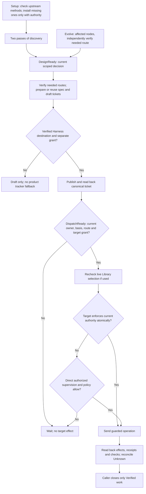

# Qualify Harness v1 on Devin

The skills express an operating contract. Loading them is not authorization,
and source regressions do not demonstrate host routing or target enforcement.
Start a pilot only with explicit authority for an isolated project scope. Do
not use a real product tracker, production effects or global installation.

The same write-boundary gate applies to tracker and bootstrap writes when
they have late-write risk. Library guards apply at the qualified store, not
to unrelated claims, trackers, repository writes or host configuration.

## Run and record

1. Use two isolated fixtures: a new project through Setup, and an existing
   Harness with a valid spec and ticket but no Setup catalog through Evolve.
   Use distinct Harness and read-only product issue spaces. Exercise a
   canonical local Harness ticket and the external Harness route only if
   it is authorized and part of the intended qualification.
2. On the new fixture, exercise Setup's
   [upstream prerequisite check](../skills/harness/harness-setup/ACTIVATION.md#install-required-upstream-skills)
   with missing originals. Check that no installation occurs without explicit
   authority. With authority, use the documented Devin project install and
   verify exact IDs and sources before dependent discovery or override authoring.
   Record pending verification if a session reload is needed.
3. Observe native loading by exact ID and source revision or digest. Test the
   expected output and an unavailable or ambiguous route. Confirm manual
   upstream routing is unaffected; verify a fresh or child session if that
   route is used. Compare the new and reused-artifact paths using observed
   loads, not estimated token savings.
4. Exercise the allowed path and refusals: draft only, wrong namespace,
   missing or stale assignment/authority, disabled or unreconciled Library
   selection, and an unsupervised non-atomic target. Confirm late revocation
   at the actual guarded target after the last caller read. Exercise an
   authorized supervised send only where policy allows it. Simulate a lost
   reply and reconcile once from receipts and destination history, without
   automatic retry or rollback.
5. Save the **actual executed flow diagram** with request/assignment IDs,
   revisions, permission gates and observed outputs. Record target receipts,
   history and before/after effect counts from an independent read. Success
   means one intended effect, zero blocked effects and no product writes.
   Reopen evidence from a fresh authorized session; say if continuation or
   any other case was not verified. Never include credentials or live grants.

See the [Setup checklist](../skills/harness/harness-setup/CHECKLIST.md) and
[Evolve checklist](../skills/harness/harness-evolve/CHECKLIST.md) for more
cases. Keep the diagram of the actual run with its evidence, not in place of
this reference flow.
