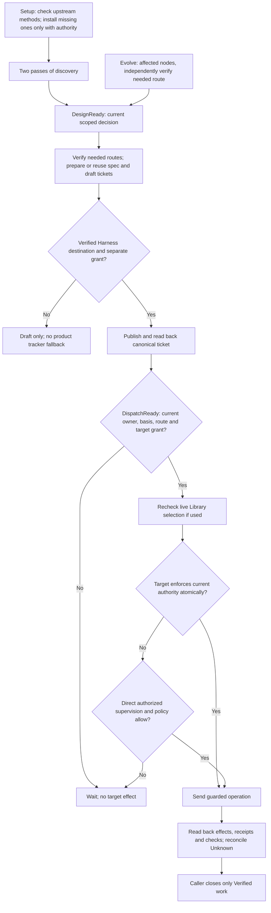

# Qualify Harness v1

## B8 qualification evidence

B8 records local checks on the docs-only branch from
`d6408aa078ebddd934a2929c2baa785e885a6714` (B7c on `main`). Skill, adapter,
script, and test files are unchanged. The
[locked architecture package](architecture/harness-v1-stage-2a-index.md)
describes the design, not an executed pilot.

### Unit and fixture results

| Check | Evidence | Limit |
| --- | --- | --- |
| Source and catalog | Strict boundary: `Boundary clean.` Catalog: `Kit data clean.` | Source only. |
| Skill budget | 20 files under `skills/`, 2,146 description characters, no missing names or name mismatches. | The two example skills are outside the default scan. Estimated tokens are not host telemetry. |
| Regressions | The targeted run passed 205 cases, including the structural and Library no-write tests used by [v1-guard](../.github/workflows/v1-guard.yml). See the PR for the full-suite result. | Three generator tests need source reports that are not in the checkout. |
| Handoff shape | `check-stage-handoff` accepted the example `prepare` envelope. Stage-contract tests cover all six operations and rejected shapes. | Shape validation does not resolve references or approve an effect. |
| Architecture | Five PNGs decoded. PlantUML 1.2025.10 and Graphviz regenerated 30 SVG panels from the three bundled sources. Three Stage 2A HTML views rendered with the network blocked. | Did not reproduce the exact composite images or rerun TLC. Stage 2B HTML needs the Devin viewer runtime; use its PNGs offline. See the [diagram gaps and erratum](architecture/harness-v1-stage-2a-index.md#giới-hạn-của-bộ-sơ-đồ-b8). |
| READMEs | Catalog reads, handoff validation, and both quickstarts run in a clean checkout. Codex CLI registered the plugin marketplace and listed the plugin as installed and enabled in a disposable home. | The named ReadMe Generation playbook was not available. Used the RFC-005 checklist, technical-writing, and unslop instead. No authenticated host invocation was run. |

Re-run the [source checks](../README.md#check-the-source) and the
[prepare](../examples/devin-prepare/README.md) and
[disabled Bot](../examples/bot-first-run/README.md) quickstarts.

### Host × skill × risk

| Host | Local or fixture measurement | Native status |
| --- | --- | --- |
| Devin | Four project-local links and pinned helper. Sampled internal routes reject wrong project and caller. Prepare and disabled Bot replays. | Unqualified. No approved isolated project run with exact-ID Source, caller access, and target evidence at this SHA. |
| Pi | Four default entries from the package manifest. Same sampled route checks; disabled Bot replay with a temporary Pi home. | Unqualified. No Pi CLI or authenticated project session. |
| Claude Code | Four default entries from the plugin manifest. Same sampled route checks. | Unqualified. No Claude Code CLI or authenticated project session. |
| Codex | Four default project links under `.agents/skills/` in the fixture. Same sampled route checks. Separate CLI registration smoke in a disposable home. | Unqualified. No authenticated project session checked the exact skill ID, source, or caller. |

**Route fixture** below means the [four B7a adapter fixtures](../tests/test_m2_quickstarts.py)
read pinned files and check project, caller, source, commit, exact ID, and
digest. For sampled internal routes, each rejects a foreign project even
with the same digest and checks that the default inventory stays unchanged.
The fixture does not invoke a skill. **Structure** means a source contract
check. **Local** means a real subprocess or a replay with scratch state.

### Eval inventory

The table lists the 22 paths from `git ls-files '*SKILL.md'` at the B8
tree. Scenario codes identify planned requests, not transcripts. There were
no native candidate runs, per-file transcript traces, or blinded scores on
any host.

| Tracked skill file | Scenario | Risk and available evidence |
| --- | --- | --- |
| [harness-m2-to-spec](../examples/devin-prepare/harness-m2-to-spec/SKILL.md) | P | Route fixture. Local replay selects the spec only when missing. |
| [harness-m2-to-tickets](../examples/devin-prepare/harness-m2-to-tickets/SKILL.md) | P | Route fixture. Local replay waits for approval of the current spec. |
| [bot-inbox](../skills/bot/bot-inbox/SKILL.md) | I | Structure: exact Bot, actor, thread, revision, and PR settlement; no live reply. |
| [bot-memory](../skills/bot/bot-memory/SKILL.md) | M | Structure: empty vs blocked, scope, conflict, and store authority; no live sync. |
| [agent-role-discovery](../skills/discovery/agent-role-discovery/SKILL.md) | S | Structure: parent-scoped dispatch; no native per-Bot selection. |
| [automation-discovery](../skills/discovery/automation-discovery/SKILL.md) | B | Structure: exact target mapping; local wake replay is not skill invocation. |
| [capabilities-discovery](../skills/discovery/capabilities-discovery/SKILL.md) | S | Structure: parent-scoped dispatch; no native capability readback. |
| [coordination-discovery](../skills/discovery/coordination-discovery/SKILL.md) | S | Structure: parent-scoped dispatch; no native tracker or claim readback. |
| [environment-discovery](../skills/discovery/environment-discovery/SKILL.md) | S | Structure: parent-scoped dispatch; no native environment observation. |
| [guidance-discovery](../skills/discovery/guidance-discovery/SKILL.md) | S | Structure: parent-scoped dispatch; no native instruction precedence evidence. |
| [hooks-discovery](../skills/discovery/hooks-discovery/SKILL.md) | S | Structure: parent-scoped dispatch; no native hook inspection. |
| [skill-discovery](../skills/discovery/skill-discovery/SKILL.md) | S | Structure: parent-scoped dispatch; no native prompt or inventory readback. |
| [state-continuation-discovery](../skills/discovery/state-continuation-discovery/SKILL.md) | S | Structure: parent-scoped dispatch; no fresh worker reopening a checkpoint. |
| [verification-discovery](../skills/discovery/verification-discovery/SKILL.md) | S | Structure: parent-scoped dispatch; no native receipt verification. |
| [workflow-discovery](../skills/discovery/workflow-discovery/SKILL.md) | S | Route fixture rejects same-digest foreign project and wrong caller. |
| [harness-evolve](../skills/harness/harness-evolve/SKILL.md) | E, B | Route fixture. Local replay adds B with A unchanged and all triggers off. |
| [harness-implement](../skills/harness/harness-implement/SKILL.md) | P, X | Route fixture. Local prepare handoff, approval revision, and no Product fallback checks. |
| [harness-library](../skills/harness/harness-library/SKILL.md) | L | Route fixture and local CLI no-write checks, including WAL and missing vs empty. |
| [harness-setup](../skills/harness/harness-setup/SKILL.md) | S, B | Route fixture. Structure checks prerequisite order and the exact config gate. Local replay adds A disabled. |
| [harness-project-implement](../skills/overrides/harness-project-implement/SKILL.md) | X | Route fixture and local override refusals. No live effect target. |
| [harness-project-to-spec](../skills/overrides/harness-project-to-spec/SKILL.md) | P | Structure and local override readback. The example spec replay uses a different ID. |
| [harness-project-to-tickets](../skills/overrides/harness-project-to-tickets/SKILL.md) | P | Structure and local override readback. The example ticket replay uses a different ID. |

Use these scenarios to prepare the next run. Give candidates only their
organic request and scoped project files, not this matrix or the rubric.

| Code | Scenario |
| --- | --- |
| S | Inspect a new repo and propose its first development workflow without applying changes. |
| E | Update an existing workflow whose approved artifacts already exist. |
| P | Draft a verification summary spec and ticket, then resume from a supplied spec revision. |
| X | Handle a canonical ticket with a withdrawn grant or a lost reply. |
| L | Inspect a saved resource when the selected store is missing, empty, or stale. |
| I | Handle a reply for an older request revision or another Bot. |
| M | Resume from shared rules when two scoped revisions conflict. |
| B | Inspect two disabled Bots and handle an occurrence for the wrong Bot or a rebind before drain. |

The [RFC-005 Eval procedure](rfc-harness-v1-detail.md#b8-pilot) requires
transcript evidence for each file, zero authority bypasses, and a blinded
judge from another model family. The repo requires Codex Sol for
orchestration subagents. No approved separate qualification runners or
cross-family judge were available. Do not promote a route on local evidence.

### Performance and effect counts

| Fixture | Measured work | Not measured |
| --- | --- | --- |
| Four adapter inventory cases | Four default entries per case before and after opening each sampled route. | Native prompt size, tokens, or install time. |
| Prepare replay | With neither artifact present and without H5 approval: one spec route, zero ticket routes. With both artifacts present: zero drafting calls. | Model requests, native latency, or a native resume. |
| Devin and Pi disabled Bot replays | Two Bots and three disabled triggers per case, zero preview/smoke file changes, first Bot unchanged when the second is added. | Hosted provisioning, cursor movement, or access enforcement. |
| Local wake ledger replay | Invalid ingress or target leaves zero rows. Two concurrent deliveries of one occurrence dispatch once. Post-commit redelivery acknowledges without another dispatch. | Hosted wake or receipt latency and production deduplication throughput. |

The native comparison of repo-only vs direct default, request/resume/wake
counts, and target writes/receipts/cursors/dedup remains unmeasured. See the
[perf gate](rfc-harness-v1-detail.md#rfc-005).

### Owner handoff at H18

1. Review the docs and evidence under H18. H18 is not an effect grant or
   approval to activate a trigger.
2. In [branch settings](https://github.com/hanh9898/harness-kit/settings/branches),
   make `v1-guard` a required check on `main` and confirm enforcement. A green
   PR check is not branch protection.
3. For native qualification, provide isolated host bindings, authorized
   callers, host runtimes and logins, and a destination that enforces its
   grant and can read back the exact effect. H19 covers exact disabled Bot
   configuration. H15 covers its manual and fresh-worker pilot. Only a
   separate H16 grant can enable one verified trigger. B8 did not change a
   live Bot or trigger. Keep unqualified triggers off.
4. Provide approved isolated candidates on different model families and
   a cross-family judge to finish blind Eval.
5. Review the Implement swimlane erratum and approve any updated swimlane or
   missing Library and Implement recovery sequence before it replaces or
   extends the locked diagram set.

## Pilot runbook

The skills express an operating contract. Loading them is not authorization,
and source regressions do not demonstrate host routing or target enforcement.
Start a pilot only with explicit authority for an isolated project scope. Do
not use a real product tracker, production effects or global installation.

The same write-boundary gate applies to tracker and bootstrap writes when
they have late-write risk. Library guards apply at the qualified store, not
to unrelated claims, trackers, repository writes or host configuration.

## Run and record

1. Use two isolated fixtures: a new project through Setup, and an existing
   Harness with a valid spec and ticket but no Setup catalog through Evolve.
   Use distinct Harness and read-only product issue spaces. Exercise a
   canonical local Harness ticket and the external Harness route only if
   it is authorized and part of the intended qualification.
2. On the new fixture, exercise Setup's
   [upstream prerequisite check](../skills/harness/harness-setup/ACTIVATION.md#install-required-upstream-skills)
   with missing originals. Check that no installation occurs without explicit
   authority. With authority, use the documented Devin project install and
   verify exact IDs and sources before dependent discovery or override authoring.
   Record pending verification if a session reload is needed.
3. Observe native loading by exact ID and source revision or digest. Test the
   expected output and an unavailable or ambiguous route. Confirm manual
   upstream routing is unaffected; verify a fresh or child session if that
   route is used. Compare the new and reused-artifact paths using observed
   loads, not estimated token savings.
4. Exercise the allowed path and refusals: draft only, wrong namespace,
   missing or stale assignment/authority, disabled or unreconciled Library
   selection, and an unsupervised non-atomic target. Confirm late revocation
   at the actual guarded target after the last caller read. Exercise an
   authorized supervised send only where policy allows it. Simulate a lost
   reply and reconcile once from receipts and destination history, without
   automatic retry or rollback.
5. Save the **actual executed flow diagram** with request/assignment IDs,
   revisions, permission gates and observed outputs. Record target receipts,
   history and before/after effect counts from an independent read. Success
   means one intended effect, zero blocked effects and no product writes.
   Reopen evidence from a fresh authorized session; say if continuation or
   any other case was not verified. Never include credentials or live grants.

See the [Setup checklist](../skills/harness/harness-setup/CHECKLIST.md) and
[Evolve checklist](../skills/harness/harness-evolve/CHECKLIST.md) for more
cases. Keep the diagram of the actual run with its evidence, not in place of
this reference flow.
