# Harness v1 · RFC kỹ thuật

**Thay đổi:** khóa các cổng v1 cho nhiều Bot độc lập, chỉ wake qua automation, trước pilot. Checklist **chưa thực thi**, không cấp quyền sửa repo hay mở/merge PR. Baseline: [main a782f24][main]; khi triển khai, pin trunk mới cho từng PR. [Kiến trúc](arc42-harness-v1.md) giữ ownership, [cổng H1–H20](arc42-harness-v1.md#human-gates) và [danh mục skill](arc42-harness-v1.md#skill-inventory); RFC giữ schema, interface và thứ tự PR; [Kiểm chứng](arc42-harness-v1.md#arc-10) giữ bằng chứng.

| RFC | Phạm vi | ADR chính |
| --- | --- | --- |
| [001](#rfc-001) | Fix-Now F1–F11, gồm override F6, discovery F10 và /correct F11. Mỗi mục là một PR riêng. | [ADR-002](adr-harness-v1.md#adr-002), [ADR-003](adr-harness-v1.md#adr-003), [ADR-004](adr-harness-v1.md#adr-004), [ADR-005](adr-harness-v1.md#adr-005), [ADR-006](adr-harness-v1.md#adr-006), [ADR-007](adr-harness-v1.md#adr-007), [ADR-008](adr-harness-v1.md#adr-008), [ADR-013](adr-harness-v1.md#adr-013), [ADR-014](adr-harness-v1.md#adr-014) |
| [002](#rfc-002) | B7a, cập nhật PR #100 và thử adapter/mapping hai Bot. | [ADR-007](adr-harness-v1.md#adr-007), [ADR-015](adr-harness-v1.md#adr-015) |
| [003](#rfc-003) | B7b, Devin Prepare Examples. | [ADR-003](adr-harness-v1.md#adr-003) |
| [004](#rfc-004) | B7c, thêm Bot qua Setup/Evolve, mặc định tắt. | [ADR-011](adr-harness-v1.md#adr-011), [ADR-015](adr-harness-v1.md#adr-015) |
| [005](#rfc-005) | B8, pilot native nhiều Bot, blind Eval và ReadMe Generation. | [ADR-012](adr-harness-v1.md#adr-012), [ADR-015](adr-harness-v1.md#adr-015) |

<a id="dependency"></a>

## Thứ tự landing và đồ thị phụ thuộc

`#92 → #95 → #96/#97 → #98 → #99` và opt-in `#93/#94` đã land; không làm lại. [#100 B7a][b7a] dùng branch hiện có; head tại baseline quan sát `3fd6cb4`. Landing **F1 → F2 → F3 → F4 → F5 → F6 → F7 → F8 → F9 → F10 → F11 → B7a → B7b → B7c → B8**. Chỉ các cạnh dưới đây là dependency nội dung.

```mermaid
flowchart LR
  M["main: #92–99 đã land"]
  M --> F1["F1 WAL"]; M --> F2["F2 catalog pin"]; M --> F3["F3 Inbox"]
  M --> F4["F4 Memory"]; M --> F5["F5 prerequisite"]; M --> F7["F7 spec"]
  M --> F8["F8 handoff"]; M --> F9["F9 split"]
  F5 --> F6["F6 ba override"]; F5 --> F10["F10 proposal-first + 11 discovery"]
  F6 --> F11["F11 structural CI"]; F7 --> F11; F8 --> F11; F9 --> F11
  F10 --> F11; F1 --> F11; F2 --> F11; F3 --> F11; F4 --> F11
  F11 --> B7a["#100 B7a · Prototype fixture / unit-live-perf"]
  B7a --> B7b["B7b · Prepare / unit-live-perf"]
  B7a --> B7c["B7c · Two disabled Bots / H19"]
  B7b --> B8["B8 · Isolated pilot / Eval / ReadMe / H18"]
  B7c --> B8
```



| PR | Parents nội dung | Thứ tự tích hợp và điểm nhận |
| --- | --- | --- |
| F1, F2, F3, F4, F5, F7, F8, F9 | Trunk | F1 giữ no-write; F2 khóa pin/scope Library; F3/F4 khóa Inbox/Memory theo Bot. F5/F7/F8/F9 giữ cổng prerequisite, spec, handoff và publish. Rebase PR chung file khi tới lượt. |
| F6, F10 | F5 | F6 thêm ba override. F10 thêm 11 discovery, hai topic Bot trả intent/mapping một đích và không mở ingress chat. Hai nhánh không gọi chéo. |
| F11 | F1–F4, F6–F10; F5 gián tiếp qua F6/F10 | Structural gate và CI. Khóa automation-only, exact target, claim/dedupe trước ACK và các cổng lifecycle. |
| B7a | F11 | Rebase PR #100; fixture bốn host cho bind/mapping hai Bot, wrong target, non-automation và retry. |
| B7b | B7a | Prototype prepare, hai example chỉ soạn nháp; không thêm hay wake Bot. |
| B7c | B7a | Fixture hai Bot độc lập, Setup và Evolve thêm Bot disabled H19; smoke tay chỉ đọc. Rebase sau B7b vì chung test, không phụ thuộc hành vi B7b. |
| B8 | B7b và B7c | Pilot route thật theo từng Bot, H15/H16/H14 độc lập, blind Eval, ReadMe Generation, sơ đồ và H18. |

Chỉ merge tuần tự theo thứ tự trên, không tích hợp đồng thời PR chung file. Whitelist theo từng lát. Không đổi checker/fixture shape, DB schema, descriptions của sáu entry, manifest, packaging, budget tool hay catalog. **H20:** owner cho go trước khi thực hiện; F1–F10 và B7a–B7c cần owner review trước merge. F11 là test/CI. **H18:** B8 có duyệt riêng. Không dùng các review này để bật trigger.

<a id="gates"></a>

## Cổng nhận chung cho mọi PR

Ký hiệu `S/=skills/harness/`, `O/=skills/bot/`; `{a,b}` nở đúng hai tên, không glob. **A** thêm, **M** sửa. Tất cả ô là tiêu chí **cần chạy**, không phải pass. Mỗi PR ghi lệnh + SHA base/head + before/after + output/receipt mở được; kiểm toàn suite và budget trước merge.

**Perf chung:** cùng runner/dữ liệu, warm-up 5, ≥30 mẫu xen kẽ baseline/head, ghi median/p95, số command/call/write; đo đúng seam từng hàng. Điều kiện p95 không quá 10% hoặc 5 ms (lấy ngưỡng lớn hơn), không thêm write/load ngoài cổng; với lần chạy host, báo raw counts và p95 mô tả nếu mẫu ít, không tuyên bố speedup. Policy có chủ duyệt nếu cần ngưỡng khác; baseline đo trước thay đổi. **Live** nghĩa là chạy script/route thật ở mức đã nêu, không dùng transcript stub thay host. Nếu native là điều kiện nhận mà chưa được quyền thử, giữ PR mở; chỉ defer sang B8 nếu owner chấp nhận cụ thể.

Baseline budget đã ghi: 859 ký tự cho bốn entry mặc định và 1073 khi gồm opt-in. Hai example theo bản thiết kế cũ chiếm 81 ký tự; đo lại tại head thực, không cộng vào mặc định.

<a id="resource-standards"></a>

### Tiêu chuẩn cho bốn nhóm tài nguyên

| Tài nguyên | Làm ở đâu và áp dụng playbook nào | Bằng chứng để nhận |
| --- | --- | --- |
| Code/CLI và test `/correct` | F1–F11 theo route thay đổi. Dùng `/tdd`: một ca quan sát được qua CLI hoặc CI, đỏ trên base hoặc mutant đúng lý do rồi xanh trên head. | `python3 -m pytest -q`, `python3 tools/check_boundary.py --root . --strict`, `python3 tools/check_kit.py --dir kit`. Xuất exit/stdout/stderr, no-write hoặc readback theo ca. `/correct` kiểm dependency, không cấp quyền runtime. |
| Skill `SKILL.md` | Mọi PR chạm skill dùng **Authoring a skill**. Chỉ giữ câu thay đổi quyết định, trỏ code/config, không lặp chỉ dẫn upstream. | Chạy `tools/skill_budget.py` strict theo nhóm bên dưới và test route chính/route deny. **Blind Eval** tất cả file tại SHA B8, gồm core, discovery, overrides và example. Không thay Eval bằng lint hoặc self-report. |
| Plugin và adapter bốn host | **Prototype** ở B7a: fixture sạch và negative cases cho Devin, Pi, Claude Code, Codex. Pin host/manifest/source, kiểm 24 mapping. Chỉ dùng route native khi có bằng chứng. B7b/B7c dùng fixture riêng cho prepare/Bot. | Lưu lệnh, profile, exact caller/source, output và lý do reject; fixture không chứng minh host thật. B8 chạy **Prototype** bằng route thật đã cấp quyền, so với fixture. Không có capability bắt buộc thì không qualify; không tự fallback. |
| Docs và README cho người dùng | Dồn `docs/`, mọi `README.md` và danh mục sơ đồ phát hành vào **B8**. Dùng **ReadMe Generation**, sau đó `/technical-writing` và `/unslop`. | Tạo từ checkout đã pin và receipt pilot, chạy lại quickstart, kiểm link giả/thiếu, gỡ tuyên bố chưa qualify. Bàn giao `.puml`, `.svg`, `.png`, `.html`; kiểm từng render. `kit/*.md` và sidecar skill chỉ sửa trước B8 khi whitelist cho phép. |

Chạy budget strict riêng theo nhóm: `python3 tools/skill_budget.py --root . --dir skills/harness --strict --json`; thêm `--dir skills/bot` khi kiểm opt-in. Đo `--dir skills/discovery`, `--dir skills/overrides` và `--dir examples/devin-prepare` riêng sau khi các nhóm xuất hiện. Đối chiếu report với inventory route thực tế của host. Baseline mô tả entry không tăng và các nhóm on-demand không vào default prompt. Kiểm 6 file lõi, 11 discovery và 3 override bằng exact inventory; chỉ đếm example ở nhóm fixture. Không đổi budget tool để làm pass.

<a id="queue-runbook"></a>

### Runbook hàng đợi PR

1. **Babysit.** Theo dõi checks và review của head hiện tại. Giao CI fail hoặc comment hợp lệ về worker của PR, giữ một claim và không nhận bằng check xanh của head cũ. Gắn commit, owner, blocker và evidence. Không đổi nhánh tích hợp trong lúc worker đang ghi.
2. **Shipping.** Chỉ đưa PR lên đầu hàng khi parents đã land, rebase lên trunk, unit/live/perf đạt và review cần thiết còn đúng head. Lấy lock tích hợp, merge tuần tự khi có quyền rồi đọc lại merge SHA/trạng thái. Không bypass required checks. B7b/B7c soạn song song được, nhưng B7c tích hợp sau B7b.
3. **Pause safely.** Ngừng dispatch, không bỏ fencing hoặc ngắt write chưa rõ. Lưu snapshot PR/base/head, claim/epoch, gate còn thiếu, evidence, effect hay receipt gốc và next step. Nếu có Unknown, chỉ đối soát trước khi giao lại; không giữ token trong mốc.
4. **Session pickup.** Mở checkpoint từ phiên mới bằng đúng ACL. Đọc lại trunk, PR head/check/review, claim/epoch, dependency và grant. Tiếp tục từ ô chưa đạt. Nếu head hoặc evidence đổi, chạy lại check bị tác động. Đọc canonical status trước khi gửi lại bất kỳ thứ gì.

Mỗi PR có owner, một kết quả quan sát được và ba ô unit/live/perf riêng. Giữ review head, links log và lý do defer theo PR. H20 trước khi bắt đầu hoặc merge thay đổi cần owner; H18 chỉ ở B8. Các playbook định nghĩa công việc triển khai sau khi có go, không phải việc đã chạy trong đợt thiết kế.

Mỗi mục PR bắt đầu bằng dependency và whitelist; đánh dấu ba ô chuẩn bị trước khi đánh giá evidence.

- [ ] Parents đã land hoặc xác định trunk độc lập. Pin base trước khi thay đổi.
- [ ] Diff chỉ chạm whitelist và có đúng một kết quả người dùng quan sát được.
- [ ] Kèm lệnh và kết quả cho unit/live/perf của head. Nếu native defer, ghi gate và owner cụ thể.

Các checklist dưới đây chưa chạy cho những PR đề xuất. [Bằng chứng lịch sử](arc42-harness-v1.md#arc-10) chỉ áp dụng cho các revision và route đã nêu ở đó.

<a id="rfc-001"></a>

## RFC-001. Fix-Now trên main và /correct

**Phụ thuộc.** Theo [đồ thị](#dependency), F5 khóa F6 và F10. F11 phụ thuộc F1–F4 và F6–F10, rồi mới rebase B7a. Thứ tự landing không biến tất cả cạnh kề nhau thành dependency nội dung.

**Hợp đồng.** Giữ [envelope](#c-envelope), [CLI Library](#c-cli), [các interface entry](#c-entry) và [bảng trạng thái](#c-errors). Các mục dưới đây giữ từng whitelist và bộ ba cổng riêng. Xem [probe main và các đối chứng](arc42-harness-v1.md#arc-11) để biết drift nào chạy được và drift nào chỉ thấy trong prose.

<a id="f1"></a>

### F1 · Library WAL no-write

**Phụ thuộc nội dung:** `main → F1 → F11`. **Interface:** [CLI và preflight](#c-cli).

**Đường lỗi.** WAL chưa qualify, store thiếu hoặc sai dạng, hoặc race giữa preflight và open không kiểm được: dừng trước khi đọc store thật. Với legacy thiếu store, giữ hành vi cũ.

**TLC.** [`NoSidecar`](arc42-harness-v1.md#arc-10)

Ghi chú nguồn: ô live F1 ghi “tái hiện ba sidecars”. Probe ghi sáu đường đọc tạo hai loại file `-wal` và `-shm`, trong đó có ba explicit reads. Đối chiếu cả hai file trên từng ca, không suy ra loại sidecar thứ ba.

**Whitelist và lát cắt**

**M** `kit/scripts/library`, `kit/LIBRARY.md`, `S/harness-library/READ.md`. **A** `tests/test_library_read_no_write.py`. Mọi read strict/explicit đi cùng preflight; legacy missing giữ hành vi cũ, legacy đọc kho đã có không được ghi. Verify cả WAL thay đổi giữa preflight/open: không có primitive chứng minh an toàn thì block route/chỉ snapshot được duyệt; không lấy kiểm header đứng một mình làm bảo đảm chống race.

**Cổng nhận**

- [ ] **unit** sáu lệnh trên WAL/malformed/rollback và malformed candidate, stdout/exit/files/bytes, race seam.
- [ ] **live** `python3 -m pytest -q tests/test_library_read_no_write.py` qua CLI thật, tái hiện hai loại sidecar trên cả ba explicit read rồi kiểm không còn tạo sidecar.
- [ ] **perf** read nhỏ/lớn, số mở tệp; zero WAL/SHM.

<a id="f2"></a>

### F2 · Catalog pin end-to-end

**Phụ thuộc nội dung:** `main → F2 → F11`. **Interface:** [Selection, distribution revision và grant](#c-library).

**Đường lỗi.** Pin lỗi hoặc store configured mất, sai hay không đọc được: không resolve bằng bundled catalog. Không biến selection quan sát thành adoption.

**TLC.** [`NoStaleGrantIssue`](arc42-harness-v1.md#arc-10), [`LibraryCommitCAS`](arc42-harness-v1.md#arc-10), [`GrantSingleUse`](arc42-harness-v1.md#arc-10)

**Whitelist và lát cắt**

**M** `kit/LIBRARY.md`, `S/harness-library/{READ,WRITE}.md`, `tests/test_library_selection.py`. `--kit-dir` vốn chạy trên main: sửa **contract/snippet/readback**, không viết lại parser; một pin cho search, select, history, resolve detail, issue/commit.

**Cổng nhận**

- [ ] **unit** hai catalog cùng ID khác digest/lifecycle; default, pin, typo, disabled, grant theo pin; hai Bot dùng chung Library nhưng selection, adoption và grant đúng scope, không dùng chéo.
- [ ] **live** `python3 -m pytest -q tests/test_library_selection.py` và trace hai CLI kit show/library đúng pin.
- [ ] **perf** path resolution không scan hai catalog; so search/selection p95.

<a id="f3"></a>

### F3 · Inbox revision

**Phụ thuộc nội dung:** `main → F3 → F11`. **Interface:** [Inbox keys và delivery receipt](#c-errors).

**Đường lỗi.** Wrong actor, thread, subject revision hoặc action không settle. Duplicate không gửi lại. Native không chứng minh revision thì manual review, không effect.

**TLC.** [`InboxRevision`](arc42-harness-v1.md#arc-10), [`NoReplyGrant`](arc42-harness-v1.md#arc-10)

**Whitelist và lát cắt**

**M** `O/bot-inbox/{SKILL,HOST}.md`, `tests/test_bot_inbox_skill.py`. Key, supersede, authenticated reply, group receipts; native không đưa revision đáng tin → manual review / no effect.

**Cổng nhận**

- [ ] **unit** exact Bot/subject/revision/action, stale+duplicate, wrong Bot/actor/thread, no grant. Hai Bot có thể có ask tương tự nhưng không settle chéo; receipt delivery không thay status của Tasks hay GitHub.
- [ ] **live** owner/worker thử opt-in cô lập hoặc defer native được duyệt; test `python3 -m pytest -q tests/test_bot_inbox_skill.py` và log đúng route.
- [ ] **perf** đếm upsert/lookup/delivery/reconcile, replay không gửi lần hai.

<a id="f4"></a>

### F4 · Memory configured-store

**Phụ thuộc nội dung:** `main → F4 → F11`. **Interface:** [Memory record, ACL, CAS và readback](#c-errors).

**Đường lỗi.** Kho configured mất, sai identity hoặc không đọc được thì Blocked. Conflict giữ bản gốc và nháp; không trả empty thay lỗi.

**TLC.** [`MemoryNotEmpty`](arc42-harness-v1.md#arc-10)

**Whitelist và lát cắt**

**M** `O/bot-memory/{SKILL,HOST}.md`, `tests/test_bot_memory_skill.py`. Tách unconfigured và blocked; readback cùng instance/topic.

**Cổng nhận**

- [ ] **unit** missing/unreadable/wrong identity, ACL, stale CAS, provenance; A không đọc/ghi kho Memory B, ngay cả khi cùng owner; `python3 -m pytest -q tests/test_bot_memory_skill.py`.
- [ ] **live** native isolated read same store và missing; fresh worker khi scope cho phép.
- [ ] **perf** một sync mỗi batch, không quét topic ngoài scope, đo cost readback.

<a id="f5"></a>

### F5 · Matt drift 1: prerequisite trước đúng Apply

**Phụ thuộc nội dung:** `main → F5 → F6/F10`. **Interface:** [Prerequisite, install và exact caller](#c-matt).

**Đường lỗi.** Inspect/advice không cài dù grant cũ còn dùng được. Thiếu method chặn node phụ thuộc; ambiguous không coi là missing.

**TLC.** [`SetupReadOnly`](arc42-harness-v1.md#arc-10), [`SetupOriginals`](arc42-harness-v1.md#arc-10), [`SetupExplicit`](arc42-harness-v1.md#arc-10), [`ObserveNoWrite`](arc42-harness-v1.md#arc-10), [`NoUserOnly`](arc42-harness-v1.md#arc-10)

**Whitelist và lát cắt**

**M** `S/harness-setup/{ACTIVATION,DISCOVERY,SKILL}.md`, `tests/test_setup_skill.py`. Rẽ inspect/advice *trước* installer; verify original methods trước node; chỉ install dưới quyền riêng.

**Cổng nhận**

- [ ] **unit** inspect với grant cũ, thiếu method, wrong caller/ambiguous.
- [ ] **live** replay Setup trước/sau trong project cô lập, 0 install ở inspect, có quyền mới install+readback.
- [ ] **perf** probe once/route trong scope, `python3 -m pytest -q tests/test_setup_skill.py` kèm trace số lần load/probe.

<a id="f6"></a>

### F6 · Matt drift 2: ba override

**Phụ thuộc nội dung:** `F5 → F6 → F11`. **Interface:** [Ba override và route readiness](#c-matt).

**Đường lỗi.** Pair draft vẫn là nháp. Sai caller, policy user-only, binding thiếu hoặc shadow thì không công bố execution ready.

**TLC.** [`ThreeOverrides`](arc42-harness-v1.md#arc-10), [`SourceIdentity`](arc42-harness-v1.md#arc-10), [`NoUserOnly`](arc42-harness-v1.md#arc-10)

**Whitelist và lát cắt**

**A** `skills/overrides/{harness-project-to-spec,harness-project-to-tickets,harness-project-implement}/SKILL.md`. **M** `S/harness-setup/ACTIVATION.md`, `S/harness-implement/{ROUTES,EXECUTION}.md`, `tests/{test_setup_skill,test_implement_handoff}.py`. Source templates và đăng ký thử H4 theo [hợp đồng route](#skill-contracts). Không thay coordinator. F6 chỉ nhận evidence đăng ký, readback và deny/nháp trên fixture; readiness vận hành còn cần spec gate F7 và host qualify.

**Cổng nhận**

- [ ] **unit** pair thiếu implement, wrong source cùng digest, user-only và duplicate IDs.
- [ ] **live** resolve ba routes trong fixture project, readback Source, ID và policy; không chạy effect ngoài quyền, kiểm route thật ở B8.
- [ ] **perf** `python3 -m pytest -q tests/test_implement_handoff.py` + trace chỉ load route cần, so 4 ca reuse.

<a id="f7"></a>

### F7 · Matt drift 3: phê duyệt spec

**Phụ thuộc nội dung:** `main → F7 → F11`. **Interface:** [Approval đúng spec revision, basis và scope](#c-refs).

**Đường lỗi.** Approval thiếu, stale hoặc bị revoke thì chưa gọi to-tickets. Đổi basis làm mất hiệu lực approval. Không hỏi lại bản còn đúng.

**TLC.** [`SpecApproval`](arc42-harness-v1.md#arc-10)

**Whitelist và lát cắt**

**M** `S/harness-implement/{ROUTES,WORK}.md`, `tests/test_implement_handoff.py`. Valid không đồng nghĩa approved; verify exact basis/revision trong legacy và v1.

**Cổng nhận**

- [ ] **unit** thiếu/stale/revoked approval đỏ cả direct và handoff; `python3 -m pytest -q tests/test_implement_handoff.py`.
- [ ] **live** đổi acceptance sau approval chặn tickets; đã duyệt cùng basis không hỏi lại.
- [ ] **perf** số lần đọc/challenge khi reuse; không thêm round-trip phê duyệt khi hợp lệ.

<a id="f8"></a>

### F8 · Matt drift 4: handoff gốc

**Phụ thuộc nội dung:** `main → F8 → F11`. **Interface:** [Handoff upstream và ref có ACL](#c-matt).

**Đường lỗi.** Route hạn chế hoặc evidence không mở được: giữ next step và ref hợp lệ, hoặc chặn. Không giả đã gọi hay dùng thêm envelope.

**TLC.** [`VerifyAndClose`](arc42-harness-v1.md#arc-10)

**Whitelist và lát cắt**

**M** `kit/PERSISTENCE.md`, `S/harness-setup/RESUME.md`, `S/harness-evolve/DESIGN-WRITEBACK.md`, `S/harness-implement/SKILL.md`, `S/harness-library/SKILL.md`, `tests/test_harness_suite.py`. Bàn giao một nguồn chuẩn, không envelope thứ bảy; restricted route fallback honest.

**Cổng nhận**

- [ ] **unit** refs đủ ACL và tách Applied/Verified/Blocked, route thiếu không giả.
- [ ] **live** phiên độc lập mở đúng nguồn/tiếp tục; `python3 -m pytest -q tests/test_harness_suite.py tests/test_stage_contract.py` không đổi payload.
- [ ] **perf** một handoff, không ghi trùng, đối chiếu số lần load và kích thước.

<a id="f9"></a>

### F9 · Split approval tại publish

**Phụ thuộc nội dung:** `main → F9 → F11`. **Interface:** [Split approval và JSON publish local Harness](#c-refs).

**Đường lỗi.** Draft revision, target role hoặc grant lệch thì không publish. Timeout sau send là Unknown. Không fallback sang Product hoặc local sau lỗi.

**TLC.** [`SplitApproval`](arc42-harness-v1.md#arc-10), [`HarnessOnly`](arc42-harness-v1.md#arc-10), [`RevocationFence`](arc42-harness-v1.md#arc-10), [`NoWorkReplay`](arc42-harness-v1.md#arc-10), [`VerifyAndClose`](arc42-harness-v1.md#arc-10)

**Whitelist và lát cắt**

**M** `S/harness-implement/WORK.md`, `kit/STAGE-CONTRACTS.md`, `tests/test_implement_handoff.py`. Cùng guard cho direct publish, v1 và legacy; material diff cần exact owner decision. Local Harness target đúng locator, không fallback Product/local sau lỗi.

**Cổng nhận**

- [ ] **unit** draft changed, approval mismatch, role Product, local payload hợp lệ.
- [ ] **live** `kit/scripts/check-stage-handoff --expect-operation publish <approved-fixture>` với shape nguyên; denied route không ticket, được phép mới readback sandbox.
- [ ] **perf** lookup một mã + semantic dedupe, 0 effect ở preflight.

<a id="f10"></a>

### F10 · Proposal-first và tách discovery

**Phụ thuộc nội dung:** `F5 → F10 → F11`. **Interface:** [Interface direct và proposal-first](#c-entry).

**Đường lỗi.** Thiếu bằng chứng thì không offer. Không ghi hay hỏi trước khi khảo sát xong. Từ chối, im lặng hoặc lựa chọn chưa rõ không mở request. Chọn hay direct không cấp grant.

**TLC.** [`ProposalReadOnly`](arc42-harness-v1.md#arc-10), [`ProposalNoEarlyAsk`](arc42-harness-v1.md#arc-10), [`ProposalNeedsPick`](arc42-harness-v1.md#arc-10), [`ProposalNeedsGrant`](arc42-harness-v1.md#arc-10)

**Whitelist và lát cắt**

**A** `kit/PROPOSAL-ENTRY.md`. **M** `S/harness-setup/{SKILL,DISCOVERY,DECISION-MAP}.md`, `S/harness-evolve/SKILL.md`, `S/harness-implement/SKILL.md`, `S/harness-library/SKILL.md`, `O/bot-inbox/SKILL.md`, `O/bot-memory/SKILL.md`, `tests/test_harness_suite.py`. Thêm đúng 11 `skills/discovery/<id>/SKILL.md` trong [inventory](arc42-harness-v1.md#skill-inventory). Setup giữ node map và thứ tự; chuyển checklist về file topic. Mỗi topic và core entry link guard gốc.

**Cổng nhận**

- [ ] **unit** direct vs no-request, literal labels, cap, no proof/decline/Something else và boundary. Test exact 11 ID, parent/order, defer, wrong caller và no default. `agent-role-discovery` trả intent theo từng Bot; `automation-discovery` chỉ đề xuất một `target_bot_id` cùng điều kiện claim/dedupe và cách dừng. Chat, @mention hoặc reply Inbox không trở thành wake.
- [ ] **live** chạy không yêu cầu cho sáu entry và topic đại diện ở lượt 1/2, chụp chat/traces/zero writes trước lựa chọn, thao tác direct không bị hỏi lại; `python3 -m pytest -q tests/test_harness_suite.py`.
- [ ] **perf** số lần đọc theo evidence cần thiết, 0 write trước chọn, 0 bước proposal trên direct.

<a id="f11"></a>

### F11 · /correct trong CI

**Phụ thuộc nội dung:** `F1–F4, F6–F10 → F11 → B7a`. **Interface:** [DAG, owner, link, mutant và quyền CI](#c-correct).

**Đường lỗi.** Mất predecessor, link hoặc preflight phải đỏ. Khi required check chưa được cấu hình, báo riêng, không bỏ qua.

**TLC.** Dùng [34 bất biến lịch sử](arc42-harness-v1.md#arc-10) làm đối chiếu. F11 khóa prose bằng structural test và seam F1, kể cả mutant [multi-bot](#multi-bot-verification); không thay TLC, ACL hoặc live-host.

**Whitelist và lát cắt**

**A** `tests/test_v1_structural_contract.py`, `.github/workflows/v1-guard.yml`. **M** `AGENTS.md`, `kit/{LIBRARY,PERSISTENCE,PROPOSAL-ENTRY}.md`, `S/harness-setup/ACTIVATION.md`, `S/harness-evolve/ADOPTION.md`, `S/harness-implement/WORK.md`, `O/bot-inbox/SKILL.md`, `O/bot-memory/SKILL.md`. Nếu required-check chưa được cấu hình, báo riêng; không lách gate.

**Cổng nhận**

- [ ] **unit** `python3 -m pytest -q tests/test_v1_structural_contract.py tests/test_library_read_no_write.py`, mutant đỏ từng invariant.
- [ ] **live** run workflow PR/sandbox, chủ động mutant ngoài branch review để chứng minh check fail đúng lý do.
- [ ] **perf** cùng runner đo CI added wall time, guard riêng mục tiêu ≤30 giây không tính checkout/install.

<a id="rfc-002"></a>

## RFC-002. B7a cập nhật PR #100

**Phụ thuộc.** F11 → B7a → B7b và B7c. Rebase [branch hiện hữu][b7a] sau F11.

**Schema và interface.** Dùng [AdapterBinding và BoundRoute](#c-profile) với sáu capability. Prototype parser/semantic guards cho [`bots[]` và mapping automation](#c-bots) trên hai Bot. Tách inspect, Apply registration và native readback. Chi tiết lệnh và kiểm source nằm trong runbook.

**Đường lỗi.** Sai link, ngoại lai, treo hoặc thiếu runtime thì dừng nguyên trạng theo runbook. Nếu source không chứng minh được, dùng `ambiguous`. Khi đích thay đổi giữa kiểm và ghi, khóa đích hoặc trả Unknown rồi đối soát.

**TLC.** [`SourceIdentity`](arc42-harness-v1.md#arc-10), [`NoUserOnly`](arc42-harness-v1.md#arc-10). Không dùng pass quickstart thay native Source/ACL.

### Whitelist và lát cắt

**A** `kit/HOST-ADAPTERS.md`, `tests/test_m2_quickstarts.py`. **M** `kit/{BOT-TEMPLATE,PERSISTENCE,STAGE-CONTRACTS}.md`, `S/harness-setup/ACTIVATION.md`, `S/harness-evolve/ADOPTION.md`. Rebase F11, giữ guard + references. Prototype bốn host: fixture kiểm load on-demand discovery/override, không auto-register thêm entry; lặp lại route thật ở B8. Tách preflight chỉ đọc → quyền link project → readback exact Source/caller/commit; không coi digest đúng ở project khác là pass.

### Cổng nhận

- [ ] **unit** `python3 -m pytest -q tests/test_m2_quickstarts.py`: copy exit 127, link exit 0, rerun idempotent, broken/foreign link, thiếu runtime, 24 mappings; validate exact target/binding, automation-only ingress, claim/dedupe trước ACK và fence đúng instance bằng fixture hai Bot.
- [ ] **live** Prototype fixture bốn host với bốn exact entry IDs và helper, một route đại diện mỗi nhóm on-demand, và same-digest foreign project. Native route chưa chứng minh ghi rõ, chỉ defer phần native sang B8 khi owner duyệt.
- [ ] **perf** preflight/rerun trong budget, 0 ghi rerun hoặc conflict.

<a id="b7a-runbook"></a>

### Runbook bốn host và 24 mappings

**Route nội bộ.** Resolve ID với caller và pin trước khi load. Devin dùng exact invocation với binding project đã duyệt; Pi nạp từng thư mục theo route phiên `--skill` đã qualify; Claude Code và Codex dùng binding project được kiểm scope hoặc route đọc đúng file source theo policy. Không claim native invocation cho route chỉ đọc file. Kiểm inventory/prompt trước và sau trên cả bốn host: không tự thêm toàn bộ `skills/discovery/` hoặc `skills/overrides/`. Nếu host chỉ load được bằng cách đổi entry mặc định, dừng route đó và ghi gap trước B8.

| Nhóm từ `BOT-TEMPLATE.md` | Devin | Pi | Claude Code | Codex | Khi thiếu primitive |
| --- | --- | --- | --- | --- | --- |
| `work-workers` · Work and workers | Boards `devin_ticket_manage` read/claim/dispatch, hoặc tracker Harness được pin; `devin_session_create`, `devin_session_events`/ `devin_session_interact` cho worker nếu được phép. | Phiên Pi riêng trong worktree cô lập, mở từ ticket gốc; có thể dùng runner được qualify. | Agent của project hoặc phiên `claude` riêng; đọc claim ở tracker gốc. | Phiên Codex trong worktree được duyệt; child/runner chỉ nếu đúng caller/cap. | Một người vận hành một claim; nếu không chứng minh độc quyền và old worker không thể ghi, không giao lại hoặc thực thi nền. Không dựng board mặc định. |
| `inbox` · Review and approvals | Native `bot-inbox`, `devin_inbox_manage` theo ACL, giao diện **Needs you**. Gửi qua route thread/transport đã duyệt và quyền send riêng. PR native auto-settle thì chỉ verify. | Opt-in `bot-inbox` qua `--skill`; hỏi trong TUI hoặc adapter Inbox hiện có. | Opt-in project-local; hỏi trong phiên hoặc adapter Inbox hiện có. Native confirmation của Claude chỉ là cổng hiệu ứng của nó. | Opt-in project-local; hỏi trong phiên hoặc adapter Inbox hiện có. Sandbox approval không thay grant đích. | Inline draft/user-in-session; nếu không có Inbox + dedupe đủ chuẩn thì không tạo card, send định kỳ, hay hứa auto-settle. Không tạo hàng đợi tự chế. |
| `memory` · Memory and continuation | Native `bot-memory` và `memory_sync` khi route đạt; **Memory** của đúng Bot, ACL và readback bằng worker mới. | Opt-in `bot-memory`, đọc snapshot scoped từ store đã chọn, tiếp tục thủ công bằng checkpoint. | Opt-in project-local, đọc store được duyệt; không coi auto-memory của host là store M2 nếu không có ACL/revision đã qualify. | Opt-in project-local, mở store/checkpoint đã duyệt; không thay bằng chat history hoặc instructions cá nhân. | Chỉ nhớ trong phiên hoặc đọc snapshot đã xuất được phép; không ghi/sync nền, không hứa nhớ qua phiên, không rơi sang store khác. |
| `domain-targets` · Domain tools and targets | Tích hợp hoặc MCP đã bind thực tế; `devin_mcp_server_manage` là quản trị cài đặt, không cấp quyền nghiệp vụ; dùng tool tracker/Git, shell hoặc provider được duyệt theo từng target. | Tool/MCP/CLI của project nếu được cấp và qualify. | Tools, MCP, CLI trong policy/permissions của project thực. | Tools, MCP, CLI qua sandbox và quyền thực. | Read-only có ACL, hoặc operator làm thủ công nếu policy cho phép, nếu không dừng. Không fallback sang namespace Product, không mang secret khi chuyển host. |
| `wake` · Schedules and events | **Automations** của đúng Bot hoặc `devin_automation_manage` khi có quyền/cap; phân biệt event của Bot, worker mới, reminder phiên. Verify occurrence key, checkpoint, ID và trạng thái của từng trigger. | Không suy lịch từ package/CLI; runner/scheduler ngoài chạy đúng caller Pi nếu đã qualify. | Không suy lịch từ plugin; runner/native mechanism chỉ sau kiểm đúng cửa sổ, caller, CLI và policy phi tương tác. | Không suy lịch từ plugin/app; automation/runner chỉ sau kiểm runtime, sandbox và checkpoint của chính route. | Mở lại thủ công từ checkpoint; giữ trigger tắt. Không poll thay event hoặc dùng session reminder như job bền. |
| `evidence-write-gate` · Evidence and guarded effects | `upload_attachment` chỉ khi có quyền chia sẻ đúng audience; đọc Git/PR bằng `git_view_pr`/`git_pr_checks`; grant/fence do đích thực thi, như Library SQLite. Commit, push, mở PR, merge và deploy là các effect khác nhau. | File/evidence trong đích đã duyệt, verify revision và grant tại đích; volatile local path không phải handoff. | Artifact tại PR/tracker đúng ACL; native tool prompt không thay claim/revision target. | Evidence PR/checks qua provider đã duyệt; workspace sandbox không xác thực App/PR actor. | Nếu recipient không mở được, dùng evidence ref khác chỉ khi có quyền, hoặc để `Blocked`. Thiếu fence bắt buộc thì dừng; non-atomic supervised chỉ khi policy cho phép và xác nhận mỗi lần gửi. |

**Một entry route trên mỗi host.** Chọn checkout đầy đủ tại commit đã duyệt và không đổi revision bên dưới session. Quyền “đọc” không cho chạy các lệnh đăng ký dưới đây. Kiểm source trong project đích, nội dung/commit, exact caller và khả năng dùng thật. Nếu tool không công bố source và không thể chứng minh bằng đường nạp độc quyền đã xác minh, đánh dấu `ambiguous`.

| Host | Lệnh và đường dẫn | Lời gọi/nối tiếp | Opt-in Inbox/Memory |
| --- | --- | --- | --- |
| **Devin** | Link project-local `.devin/skills/<id>` từ checkout đầy đủ, theo lệnh dưới đây. Không chép rời thư mục với `npx skills add <checkout>`. Không đổi global. | `skill_invoke({"skill":"harness-setup"})`; tương tự ba ID khác. So đúng Source project và content thực; nếu cache sai project, mở session mới chỉ chứa project đích và kiểm lại trước khi tin. Mở worker mới đúng Bot khi qualify persistent. | Ưu tiên exact ID native `bot-inbox`/`bot-memory`; không đăng ký cùng ID để shadow. Nếu native không đạt, chỉ dùng adapter ngoài hoặc operator đã chọn với bare-ID collision đã giải quyết; nếu không, tắt route. |
| **Pi** | Trong project: `pi --skill "$KIT/skills/harness"` cho một phiên, hoặc `pi install --local "$KIT"` để ghi `.pi/settings.json`. `pi list --approve` là lựa chọn trust cho lệnh đó, không lưu trust. Không dùng bản Git trôi `@main` trong qualification. | `/skill:harness-setup` và tương tự. `/reload` sau thay nguồn hoặc mở phiên mới sạch để kiểm readback. Package chỉ đăng ký skill, không inject role. | Chọn một hoặc hai `--skill "$KIT/skills/bot/<id>"` riêng, gọi `/skill:<id>` nếu đã xác minh, không đổi package. |
| **Claude Code** | Thử một phiên: `claude --plugin-dir "$KIT"`. Cài lâu: `claude plugin marketplace add "$KIT"`, rồi `claude plugin install harness-kit@harness-kit` (mặc định user scope, phải xin quyền trước); nếu cần scope khác chọn rõ `--scope local` hoặc `--scope project` theo policy và kiểm settings/marketplace thực tế. Không giả định local install giới hạn toàn bộ metadata marketplace. | Mở lại hoặc reload theo host/version; gọi `/harness-kit:harness-setup` và các ID cùng prefix. Worker mới đọc đúng checkpoint còn quyền. | Nếu cần portable, link riêng project-local `.claude/skills/<id>` tới `"$KIT/skills/bot/<id>"`, exact `/<id>`, sau kiểm duplicate; không đưa vào plugin mặc định. |
| **Codex** | Chọn plugin: `codex plugin marketplace add "$KIT"`, `codex plugin add harness-kit@harness-kit`; **hoặc** link bốn ID trong `.agents/skills/<id>` theo cơ chế hiện có. Không áp cả hai. Project-local là lựa chọn hẹp. | Mở phiên mới; kiểm `/plugins` khi dùng plugin và picker `/skills`/`$`; gọi `$harness-setup` và ba ID còn lại. Runner phải load đúng scope và evidence riêng. | Link riêng project-local `.agents/skills/<id>` tới `"$KIT/skills/bot/<id>"`, gọi `$<id>` sau kiểm duplicate. Không sửa manifest. |

**Devin, trình tự B7a:** dùng checkout đầy đủ, sạch, đúng full SHA. Trước khi tạo thư mục hoặc link: verify `git`, `python3`, `realpath`, bốn `SKILL.md`, helper Library executable/callable và tính nhất quán *tất cả* destination trong project. Có file/link sai/treo → exit 2, giữ nguyên toàn bộ. Nếu root đăng ký không thuộc project đã duyệt, dừng. Chỉ sau grant link: tạo `$PROJECT/.devin/skills` và symlink đúng chỗ còn thiếu; giữ link đúng, không overwrite hoặc sửa global. Sau link chạy `"$(realpath "$PROJECT/.devin/skills/harness-library")/../../../kit/scripts/library" --help`, rồi native probe bốn exact IDs, project Source, pin và caller. Giữa kiểm và ghi nếu có tác nhân khác, khóa đích hoặc báo Unknown/reconcile; không tự xóa partial links. Không kết luận từ `skill_list(path)` âm. Dùng cùng nguyên tắc khi chọn Codex project-local.

<a id="rfc-003"></a>

## RFC-003. B7b Devin Prepare Examples

**Phụ thuộc.** B7a → B7b → B8. B7b và B7c độc lập về hành vi nhưng B7c rebase sau B7b.

**Schema và interface.** Dùng [prepare v1](#c-envelope), [DecisionRef và approval](#c-refs) và [ma trận bốn tổ hợp artifact](#c-matt). Hai ID riêng chỉ soạn nháp, không đăng ký execution override thứ ba.

**Đường lỗi.** Spec thiếu, stale hoặc chưa chốt thì chặn tickets. Không có quyền lưu thì trả inline. Sai source, caller hoặc invocation policy thì dừng, không publish, claim hay tạo dữ liệu Git.

**TLC.** [`SourceIdentity`](arc42-harness-v1.md#arc-10), [`NoUserOnly`](arc42-harness-v1.md#arc-10), [`SpecApproval`](arc42-harness-v1.md#arc-10), [`ThreeOverrides`](arc42-harness-v1.md#arc-10).

### Whitelist và lát cắt

**A** `examples/devin-prepare/{prepare.json,decision.json,harness-m2-to-spec/SKILL.md,harness-m2-to-tickets/SKILL.md}`. **M** `S/harness-setup/ACTIVATION.md`, `S/harness-implement/ROUTES.md`, `tests/test_m2_quickstarts.py`. Pin repo & upstream ref, project cô lập; hai IDs ví dụ không thay ba overrides của workflow mới.

### Cổng nhận

- [ ] **unit** `kit/scripts/check-stage-handoff --expect-operation prepare examples/devin-prepare/prepare.json`, chỉ phần thiếu, no default.
- [ ] **live** exact source/caller + bốn tổ hợp artifact, đúng spec gate trước tickets; đổi acceptance đổi draft, 0 publish/claim/Git/labels, thiếu quyền lưu chỉ inline.
- [ ] **perf** 0/1/1/2 lần author tương ứng, không hỏi lại nếu đã duyệt.

<a id="b7b-fixture"></a>

### Fixture và pin upstream

**B7b fixture:** upstream đối chiếu tại `abeeaf95660ba9e8b7c753eb38f441ca707a8823`; không nạp original user-only. JSON `prepare` có request, scope, ref decision revision/basis, acceptance, refs dependencies và hai needed-route refs. `decision.json` giữ record nguồn **mở được trong fixture**; không trỏ tracker thật. README quickstart viết ở B8. Fixture chỉ soạn hai ID example trong đúng project; thiếu spec thì handoff inline, người duyệt spec revision rồi mới gọi example tickets; acceptance thay làm đổi nháp. Không giả `draft_ref` bền.

<a id="rfc-004"></a>

## RFC-004. B7c Thêm Bot, cấu hình mặc định tắt

**Phụ thuộc.** B7a → B7c → B8. Rebase sau B7b do chung file.

**Schema và interface.** Hai [selection](#c-library) độc lập cho role và contract của mỗi Bot. Setup thêm A, Evolve thêm B trong fixture. H19 cho phép từng cấu hình disabled và readback; phát một [bot-setup v1](#c-envelope) cho đúng instance, không gộp B vào A. Smoke tay chỉ đọc, không qualify pilot/wake và không bật trigger.

**Đường lỗi.** Nếu đã xác nhận chưa cấu hình store, chỉ preview. Store đã bind nhưng mất, sai identity hoặc không đọc được thì Blocked. Thiếu quyền, digest liên kết, selection hiệu lực hoặc bằng chứng role/tool thật thì không chạy vượt preview.

**TLC.** [`SourceIdentity`](arc42-harness-v1.md#arc-10), [`BotSelections`](arc42-harness-v1.md#arc-10). Worker mới và wake thuộc B8.

### Whitelist và lát cắt

**M** `tests/test_m2_quickstarts.py`, `S/harness-setup/ACTIVATION.md`, `S/harness-evolve/ADOPTION.md`. Giữ gate F11, dùng đúng adapter B7a; không thêm route wake. Fixture hai Bot nằm cùng test; README quickstart viết ở B8. Pin role mẫu `software-factory` và contract `bot-portable-template` độc lập; kiểm linked digest và store/scope/effective của từng selection.

### Cổng nhận

- [ ] **unit** `python3 -m pytest -q tests/test_m2_quickstarts.py`: Setup/Evolve thêm Bot với mọi trigger tắt; role/contract riêng, wrong store, pin và preview. Thêm hoặc deny B không đổi binding, grant, revision, receipt hay các trigger của A.
- [ ] **live** Devin Bot thử: kiểm Instructions, quan sát Needs you, một lượt đọc tay; Pi project/HOME cô lập, role hiện trong prompt thật; không ACL thì giữ preview.
- [ ] **perf** hai selection đọc, 0 writes khi preview, 0 schedule/notify, đo thời gian đến readback.

<a id="b7c-smoke"></a>

### Smoke Devin và Pi

**B7c smoke:** đọc hai `selection` strict và `kit --dir "$PINNED_KIT_DIR" show <id>`; role trong `kit/BOT-ROLES.md#software-factory` và contract `bot-portable-template`. No-store đã xác nhận chỉ preview. Nếu duyệt tạo Bot thử: operator kiểm đúng instance, Instructions/Memory, đọc lại config và quan sát Needs you (không tạo ask). Cho phép đúng bài đọc fixture, không tạo commit, PR, ticket/notify/lịch. Pi kiểm flags của phiên bản và HOME/project riêng; ví dụ `pi --skill "$KIT/skills/harness" --no-extensions --no-mcp --no-session --tools read --append-system-prompt "$ROLE_DRAFT" --print "Đọc fixture được cấp và tóm tắt; không ghi, không gửi."`. Render file role ngoài đích chỉ khi cấp phép ghi nháp; thiếu quyền thì inline. Không chứng minh được tool list hoặc role thật → preview; package không inject role.

<a id="rfc-005"></a>

## RFC-005. B8 Live Pilot, blind Eval và ReadMe Generation

**Phụ thuộc.** B7b + B7c → B8. H15 duyệt từng effect thử, H18 duyệt gói cuối. Hai quyền không thay nhau, và không thay grant effect hay H16.

**Schema và interface.** Dùng [binding](#c-profile), [`bots[]` và mapping automation](#c-bots), [wake và checkpoint](#c-errors) và [runbook bốn host](#b7a-runbook). Lưu trace host/skill/rủi ro, ma trận file × prompt × evidence và receipt có ACL. B8 chạy trên contract đã khóa ở B7a/B7c, không đổi schema hay envelope.

**Đường lỗi.** Thiếu fence, receipt, ACL hoặc blinding thì không nhận lát đó. Giữ trigger chưa qualify tắt, không poll hoặc dùng chat thay wake. Unknown chỉ đối soát; rebind sau drain riêng cho Bot đích, vẫn tắt. Xem [ranh giới chưa chứng minh](arc42-harness-v1.md#arc-11).

**TLC.** [`B8PilotAuthorized`](arc42-harness-v1.md#arc-10), [`FreshWorker`](arc42-harness-v1.md#arc-10), [`TriggerReadback`](arc42-harness-v1.md#arc-10), [`TriggerIsolation`](arc42-harness-v1.md#arc-10), [`WakeOnce`](arc42-harness-v1.md#arc-10), [`DrainBeforeRebind`](arc42-harness-v1.md#arc-10), [`B8OwnerReview`](arc42-harness-v1.md#arc-10). B8 cũng thử các lỗi quyền, store, workflow, proposal, Inbox và Memory ở các lát còn lại.

### Whitelist và lát cắt

**M** `README.md`, `kit/README.md`, `docs/{harness-v1,generation-notes}.md`. **A** `examples/{devin-prepare,bot-first-run}/README.md` và `docs/{arc42-harness-v1,adr-harness-v1,rfc-harness-v1-detail}.md`. **A/M** chỉ asset `.puml`, `.svg`, `.png`, `.html` trong [danh mục sơ đồ](arc42-harness-v1.md#diagram-contract) dưới `docs/architecture/`: C4, DFD, 20 swimlane, ba Recovery Sequence, entry/Bot/Library Statechart. Không lẫn sửa skill/adapter do Eval phát hiện. Nếu có lỗi chặn, lập PR fix riêng được duyệt làm dependency B8 rồi pin lại baseline và chạy lại lát bị ảnh hưởng.

### Cổng nhận

- [ ] **unit** full suite, strict boundary, kit, budgets và tái tạo diagram; `python3 -m pytest -q -p no:cacheprovider`.
- [ ] **live** suite [B8](#b8-pilot) và [bằng chứng kiến trúc](arc42-harness-v1.md#arc-10): pilot cả 4 host, blind Eval mọi `SKILL.md`, README Generation, owner duyệt cuối; unqualified giữ tắt.
- [ ] **perf** so path repo-only/direct default, số request/resume/wake, write/receipt/cursor/dedup, có sample size, native vs local riêng.

<a id="b8-pilot"></a>

### Kịch bản live và tiêu chí owner

1. **Preflight quyền thử.** Chốt hosts/project/org, phiên bản, repo SHA/route source/caller, scope đọc/ghi, dữ liệu thử, cách dừng, recipient ACL và native vs fixture. H15 cho phép từng effect pilot trên đúng binding, chưa cho bật. Kiểm hai Bot riêng, pilot tay và worker mới khi trigger tắt. Nếu có H16, bật đúng một ID trên A, xác minh chỉ A nhận occurrence, trigger khác và B không đổi. Dọn theo grant và đọc lại; H18 chỉ duyệt gói cuối. Dùng [bảng kiểm multi-bot](#multi-bot-verification).
2. **Prototype trên route thật bốn host.** So fixture B7a với exact source/caller, trace và output của route thật đã cấp quyền; fixture pass không thay native. Repo-only không hỏi Bot; Bot-only không repo giả; deny một đích không đổi các đích đã verify; resume đúng store/route/receipt, missing khác empty. Devin kiểm Source, ACL và [Tasks/Inbox](#devin-tasks-inbox). Pi, Claude Code, Codex kiểm route đã chọn và output đúng scope; thiếu primitive thì unqualified/manual. Negative: same digest foreign caller, stale Library/CAS/rename, revoke sau last read, timeout sau commit, Inbox sai Bot/actor/thread/revision, Memory conflict/ACL, duplicate wake, rebind chưa drain, approve trigger khác. Đếm tại đích; revoke không undo commit.
3. **Blind Eval playbook.** Kiểm kê `git ls-files '*SKILL.md'` tại SHA B8, gồm sáu entry, 11 discovery, ba override, hai example và mọi SKILL.md khác tại SHA đó; lưu ma trận file × prompt × bằng chứng đã thật sự mở. Rubric kín (5 điểm độc lập: đúng scope, đúng cổng người dùng, không side effect trái phép, đọc đúng route/caller, continuation có evidence). Cùng organic prompt trên workspace riêng tên sạch, không nhắc skill chain/rubric/eval, không lộ variant. Candidate là host/model được khảo sát, khác với reviewer điều phối. Judge khác family, blind nhãn và model, mọi variant trên một thang; đọc transcript đúng workspace + output trước tổng hợp. Nếu rule subagent/model không cho đa family, dùng qualification host runner được duyệt; không đạt blinding thì chưa pass. Tiêu chí cứng: **zero bypass quyền** và có trace cho từng file; không suy từ self-report.
4. **ReadMe Generation playbook.** Đầu vào chỉ là tree pin, matrix quyền/host, quickstart chạy được và receipt pilot; tạo README tiếng người dùng: dùng khi nào, cài project-local, profile/mode, entry mặc định/opt-in, đường read-only, smoke và bất khả năng. Đối chiếu mọi lệnh/link với checkout sạch; số liệu không chứng minh thì gỡ, chưa qualify thì ghi đúng nhãn. Chạy sau Eval, dùng /technical-writing cho quickstart và /unslop để cắt câu không có bằng chứng. Tên playbook được yêu cầu chưa thấy ở catalog/session này; trước B8 resolve bản owner định dùng, không tuyên bố đã chạy.
5. **Gói owner review.** Checklist unit/live/perf, raw commands/receipt/trace redacted, bảng evidence theo host/skill/rủi ro, remaining blockers và lựa chọn giữ disabled. Thay đổi material sau review → kiểm lại đúng lát và duyệt lại; B8 chưa merge trước H18. Đối chiếu [cổng Human và tiêu chí render](arc42-harness-v1.md#diagram-contract) trên bộ sơ đồ được duyệt.

<a id="multi-bot-verification"></a>

### Bảng kiểm chứng nhiều Bot

Tất cả các ca dưới đây **chưa chạy**. Fixture dùng A/B, trigger A1/A2/B1, cùng Library và kho trạng thái tách. B8 chỉ chạy các lát native có quyền; nếu chưa có H16, không tuyên bố live wake đạt. Các [kết quả TLC một Bot](arc42-harness-v1.md#arc-10) không thay các ca này.

| Lát và PR chịu trách nhiệm | Ca đối chứng hoặc mutant cần chặn | Bằng chứng phải thu |
| --- | --- | --- |
| Library, Inbox, Memory và task state (F1–F4, B7a, B8) | A dùng ref/ACL hoặc reply của B; Library tạo sidecar khi đọc; coi Inbox Done là Tasks Closed/PR merged; coi assignee là claim hoặc board do Bot quản lý là private. | Hai snapshot theo Bot và ACL tại đích; không tạo sidecar hoặc đổi B; Tasks từ chối claim/dispatch khi blocked, dispatch lại khi đã claim; worker con đọc đúng Inbox; status Tasks/GitHub không lấy từ Inbox. |
| Biên ingress (F10/F11, B7a, B8) | Chat trực tiếp, @mention, tin Bot, reply Inbox, hoặc payload chat giả dạng sự kiện tích hợp. Bỏ kiểm ingress trong mutant. | Không claim occurrence, dispatch, positive ACK hoặc effect. Entry/Inbox hợp lệ vẫn chạy tương tác trong quyền; không gọi wake. |
| Exact mapping (F11, B7a, B8) | Thiếu hoặc trùng `bot_id`, target không tồn tại, array target, trigger đăng ký hai Bot, scope/revision cũ hoặc ID A gửi đến B; bỏ kiểm exact target. | Reject trước claim/ACK, không fallback. Cùng provider occurrence ID trên mapping hợp lệ khác nhau tạo key khác, không đụng checkpoint bên kia. |
| Atomic claim/dedupe (F11, B7a, B8) | Hai giao đồng thời, crash trước commit claim, crash sau commit nhưng trước ACK, redelivery sau ACK; mutant ACK sớm hoặc thiếu khóa. | Trace đích ghi claim + uniqueness trước ACK. Trước commit không ACK; lặp sau commit đọc record cũ, không claim/dispatch/execute lần hai vì delivery. ACK không phải effect receipt. |
| Thêm Bot mặc định tắt (B7c) | Setup thêm A, Evolve thêm B; không H19 hoặc H19 cho sai Bot; mutant auto-enable. | Không H19 thì không cấu hình. Có H19 thì một readback disabled và một `bot-setup` per Bot; A không đổi khi thêm B. Không tạo trigger active dù đã có grant của Bot khác. |
| Pilot và bật từng trigger (B8) | H15 sai binding, worker mới sai ACL, H16 cho A1 nhưng bật A2/B1, hoặc thiếu readback. | H15 → manual → worker mới trên binding hiện hành. Chỉ A1 có H16 và readback active; khi thử delivery chỉ A wake; A2, B1 và B không đổi. |
| Unknown và rebind riêng (F11, B7a, B8) | Mất effect receipt, rebind A khi chưa drain hoặc H14 sai Bot; late delivery trên binding cũ; duplicate sau rebind. | Unknown giữ checkpoint, H13 không sinh effect, không retry/reassign/rollback. Đọc lại cũ tắt và fence trước H14; binding mới của A tắt, continuity hoặc không bật; B và receipt của B không đổi. |

<a id="contracts"></a>

## Hợp đồng kỹ thuật dùng chung

Các mục này chứa schema, lệnh, đường lỗi và guard mà các RFC tham chiếu. Chúng không tạo whitelist chung hoặc cấp quyền sửa ngoài whitelist của PR.

<a id="c-layout"></a>

### Bố trí file và trách nhiệm

| Đường dẫn từ root | Hợp đồng duy nhất |
| --- | --- |
| `kit/STAGE-CONTRACTS.md`, `kit/scripts/check-stage-handoff`, `tests/fixtures/stage-handoffs/` | Sáu envelope v1, parser shape, fixture; chỉ sửa prose tại PR đã nêu. |
| `kit/M2-CONFIG.md`, `kit/PERSISTENCE.md`, `kit/RECOVERY.md` | Profile/mode/binding và continuation; không tạo file consumer bắt buộc. |
| `kit/HOST-ADAPTERS.md` (B7a), `kit/BOT-TEMPLATE.md`, `kit/BOT-ROLES.md` | Bốn adapter, sáu capabilities, role/contract mẫu. Inbox/Memory giữ `HOST.md` canonical. |
| `kit/LIBRARY.md`, `kit/scripts/library`, `kit/scripts/kit` | CLI thật, no-write/store/selection/grant và catalog pin. |
| `kit/PROPOSAL-ENTRY.md` (F10) | Một contract proposal-first cho mọi entry/topic; không schema vận chuyển hoặc registry mới. |
| `skills/harness/harness-setup/` | Entry và `DISCOVERY.md`, `DECISION-MAP.md`, `ACTIVATION.md`, `RECORD-FORMAT.md`, `RESUME.md`: discovery, quyền đăng ký, record và handoff. |
| `skills/harness/harness-evolve/` | Entry và `ADOPTION.md`, `OBSERVE.md`, `CHANGE-FLOW.md`, `UPDATE.md`, `DESIGN-WRITEBACK.md`: delta, route, writeback; không reinstall. |
| `skills/harness/harness-implement/` | Entry và `WORK.md`, `ROUTES.md`, `EXECUTION.md`: prepare/publish/execute và cổng đích. |
| `skills/harness/harness-library/` | Entry và `READ.md`, `WRITE.md`, `UPDATE.md`, `PROMOTION.md`: Library và selection. |
| `skills/bot/bot-inbox/{SKILL,HOST}.md`, `skills/bot/bot-memory/{SKILL,HOST}.md` | Opt-in; identity/ACL, người dùng, delivery/sync, fallback. |
| `skills/discovery/<id>/SKILL.md` | F10. 11 node handlers, một checklist mỗi file. |
| `skills/overrides/<id>/SKILL.md` | F6. Ba cơ chế override project-local, không auto-register. |
| `examples/devin-prepare/`, fixture Bot trong `tests/test_m2_quickstarts.py` | Ví dụ B7b/c. README hướng dẫn ở B8, không auto-register. |
| `tests/test_v1_structural_contract.py`, `tests/test_library_read_no_write.py`, `.github/workflows/v1-guard.yml` | /correct và seam no-write; không runner/framework runtime mới. |

<a id="c-envelope"></a>

### Sáu envelope v1, checker và resolve

Schema chính xác dưới đây dùng ký hiệu `R` = chuỗi Unicode in được, không rỗng, không có khoảng trắng hai đầu; `T` = chuỗi có ít nhất một ký tự không phải khoảng trắng; `N` = số nguyên không âm, không nhận boolean hoặc float; `V = N | R`; `B` = boolean JSON; `[X]` = mảng phần tử X, có thể rỗng; `[X]+` = mảng không rỗng. Mọi đối tượng đều đóng; khóa ngoài schema, khóa trùng, `null`, `NaN` và `Infinity` bị từ chối. Mọi envelope là JSON UTF-8, có `version: 1` (số nguyên) và `operation` đúng một hàng. Dấu `?` chỉ trường được bỏ qua, không biểu thị giá trị null.

| `operation` | Trường bắt buộc ngoài envelope | Trường tùy chọn và ràng buộc |
| --- | --- | --- |
| `prepare` | `scope_ref:R`, `decision_ref:R`, `acceptance:[T]+`, `dependency_refs:[R]`, `needed_route_refs:[R]` | Chính xác một trong `request:T`, `request_ref:R`; thêm `spec_ref:R?`, `ticket_ref:Ticket?`. |
| `publish` | `draft_ref:R`, `target:{instance:R,namespace:R,role:R}`, `work_id:R`, `grant_ref:R` | Không có. `work_id` bền theo công việc logic, không sinh mới khi timeout. |
| `execute` | `request_ref:R`, `scope_ref:R`, `decision_ref:R`, `ticket_ref:Ticket`, `assignment_ref:R`, `route_ref:R`, `effect_ref:R`, `expected_target_revision:V` | `selection_ref:R?`; bắt buộc về ngữ nghĩa nếu job dùng Library. |
| `selection` | `store_ref:R`, `scope_ref:R`, `source:supplied\|saved`, `id:R`, `selection_revision:N`, `enabled:B`, `available:B`, `effective:B`, `evidence_refs:[R]` | `distribution_revision:V?`, `content_revision:V?`, `digest:R?`, `lineage_ref:R?`, `hold_ref:R?`; xem quy tắc nguồn bên dưới. |
| `result` | `assignment_ref:R`, `target_ref:R`, `target_revision:V`, `outcome:Applied\|Denied\|Unknown`, `verification_refs:[R]`, `evidence_refs:[R]`, `next_step:T` | Ít nhất một trong `effect_id:R`, `request_id:R`; ít nhất một trong `receipt_ref:R`, `history_ref:R`. Một `history_ref` không phải biên nhận. |
| `bot-setup` | `instance_id:R`, `template_ref:R`, `contract_ref:R`, `scope_ref:R`, `adapter_ref:R`, `configuration_ref:R`, `evidence_refs:[R]`, `disabled_capabilities:[R]` | Không có. Setup/Evolve phát riêng cho mỗi Bot sau readback tắt. Instance và refs resolve đúng một Bot/binding. Không đổi ID thao tác hoặc thêm trường. |

`Ticket = {instance:R, namespace:R, id:R, revision:V}`. Với `selection.source=supplied`, luôn cần `distribution_revision`, không có `content_revision`, và cần `digest` nếu `available=true`. Với `saved`, không có `distribution_revision`; cần `content_revision` nếu `available=true`; B1 chấp nhận `digest` tùy chọn, M2 không phát nó cho saved. Với cả hai: `effective == enabled && available`. `disabled_capabilities` vẫn là mảng R, không siết checker cũ; producer M2 liệt kê các ID capability bị tắt thật trong lần readback. `target_revision` lấy quan sát được hoặc revision kỳ vọng nếu chưa có quan sát, không suy ra đã commit.

`kit/scripts/check-stage-handoff --expect-operation <op> <file>` giữ nguyên: **0** đúng hình dạng, **1** không đọc được hoặc sai dữ liệu/thao tác, **2** lỗi cách dùng argparse. Không resolve reference, network, SQLite hay quyền; không có tác động ghi. B2 giữ ref legacy không version cho caller cũ qua cùng semantic gate, không tự hạ xuống legacy khi dữ liệu đã có `version` nhưng sai. Producer mới dùng v1. Trong cùng phiên có thể chuyển cấu trúc qua host; qua phiên chỉ lưu draft/checkpoint ở nơi đã được phép, nếu không trả trong phiên. Không ghi token hoặc nhúng cả spec, ticket, transcript.

**Resolve theo thao tác.** `decision_ref` mở đúng ID, revision, basis. `assignment_ref` mở ID, chủ, epoch, claim và đích. `route_ref` mở exact ID/source/digest/caller theo đúng host; `effect_ref` mở đúng effect, payload digest, đích và quyền hiện hành. Người nhận mở từng ref trong scope của chính mình, kiểm giao giữa chúng và so revision tại đích. Khi shape đúng mà ref không mở được hoặc lệch, giữ draft hoặc chặn nhánh phụ thuộc. Mỗi `execute` chỉ có một đích; nếu tác động cần nhiều selection, `selection_ref` trỏ bản quyết định sử dụng có danh sách ref selection v1; trường vẫn là R. Role portable luôn resolve riêng hai selection: role đã chọn, và `bot-portable-template`.

<a id="c-profile"></a>

### Profile, mode và adapter binding

Schema dưới đây mô tả các giá trị nằm trong quyết định/configuration đã có, không yêu cầu thêm tệp hay store. Khi trao đổi máy, dùng JSON UTF-8; schema JSON Schema 2020-12 viết bằng YAML. Có thể render từ bản ghi gốc; không sửa cả projection lẫn bản gốc. Sau shape, áp dụng quy tắc ngữ nghĩa tại biên. Không thêm trường envelope, dependency JSON Schema hay checker runtime.

```yaml
$schema: https://json-schema.org/draft/2020-12/schema
oneOf:
  - $ref: '#/$defs/targetProfile'
  - $ref: '#/$defs/runtimeConfig'
  - $ref: '#/$defs/botConfig'
$defs:
  ref:
    type: string
    minLength: 1
  revision:
    oneOf:
      - {type: integer, minimum: 0}
      - {$ref: '#/$defs/ref'}
  targetProfile:
    type: object
    additionalProperties: false
    properties:
      version: {const: 1, type: integer}
      target_profile: {enum: [repo-only, bot-only, repo-and-bot]}
      scope_ref: {$ref: '#/$defs/ref'}
      owner_ref: {$ref: '#/$defs/ref'}
      repo_ref: {$ref: '#/$defs/ref'}
      bot_ids:
        type: array
        minItems: 1
        uniqueItems: true
        items: {$ref: '#/$defs/ref'}
    required: [version, target_profile, scope_ref, owner_ref]
    oneOf:
      - properties: {target_profile: {const: repo-only}}
        required: [repo_ref]
        not: {required: [bot_ids]}
      - properties: {target_profile: {const: bot-only}}
        required: [bot_ids]
        not: {required: [repo_ref]}
      - properties: {target_profile: {const: repo-and-bot}}
        required: [repo_ref, bot_ids]
  runtimeConfig:
    type: object
    additionalProperties: false
    properties:
      version: {const: 1, type: integer}
      mode: {enum: [interactive, persistent-bot]}
      scope_ref: {$ref: '#/$defs/ref'}
      bot_id: {$ref: '#/$defs/ref'}
      instance_id: {$ref: '#/$defs/ref'}
      adapter_ref: {$ref: '#/$defs/ref'}
      checkpoint_ref: {$ref: '#/$defs/ref'}
    required: [version, mode, scope_ref]
    oneOf:
      - properties: {mode: {const: interactive}}
        not:
          anyOf:
            - required: [bot_id]
            - required: [instance_id]
            - required: [checkpoint_ref]
      - properties: {mode: {const: persistent-bot}}
        required: [bot_id, instance_id, adapter_ref, checkpoint_ref]
  botConfig:
    type: object
    additionalProperties: false
    required: [version, library_ref, bots, automations]
    properties:
      version: {const: 1, type: integer}
      library_ref: {$ref: '#/$defs/ref'}
      bots: {type: array, items: {$ref: '#/$defs/bot'}}
      automations: {type: array, items: {$ref: '#/$defs/automation'}}
  bot:
    type: object
    additionalProperties: false
    required: [bot_id, role, contract, binding, bot-inbox, bot-memory, grant, revision, receipt]
    properties:
      bot_id: {$ref: '#/$defs/ref'}
      role: {$ref: '#/$defs/ref'}
      contract: {$ref: '#/$defs/ref'}
      binding: {$ref: '#/$defs/botBinding'}
      bot-inbox: {$ref: '#/$defs/botStore'}
      bot-memory: {$ref: '#/$defs/botStore'}
      grant: {type: array, uniqueItems: true, items: {$ref: '#/$defs/ref'}}
      revision: {$ref: '#/$defs/revision'}
      receipt: {type: array, uniqueItems: true, items: {$ref: '#/$defs/ref'}}
  botBinding:
    type: object
    additionalProperties: false
    required: [instance_id, binding_revision, scope_ref, owner_ref, adapter_ref, configuration_ref, checkpoint_ref]
    properties:
      instance_id: {$ref: '#/$defs/ref'}
      binding_revision: {$ref: '#/$defs/revision'}
      scope_ref: {$ref: '#/$defs/ref'}
      owner_ref: {$ref: '#/$defs/ref'}
      adapter_ref: {$ref: '#/$defs/ref'}
      configuration_ref: {$ref: '#/$defs/ref'}
      checkpoint_ref: {$ref: '#/$defs/ref'}
  botStore:
    type: object
    additionalProperties: false
    required: [state]
    properties:
      state: {enum: [not-opted-in, bound]}
      store_ref: {$ref: '#/$defs/ref'}
    oneOf:
      - properties: {state: {const: not-opted-in}}
        not: {required: [store_ref]}
      - properties: {state: {const: bound}}
        required: [store_ref]
  automation:
    type: object
    additionalProperties: false
    required: [automation_id, target_bot_id, binding_revision, scope_ref, kind, trigger_ref, source_id]
    properties:
      automation_id: {$ref: '#/$defs/ref'}
      target_bot_id: {$ref: '#/$defs/ref'}
      binding_revision: {$ref: '#/$defs/revision'}
      scope_ref: {$ref: '#/$defs/ref'}
      kind: {enum: [schedule, integration-event]}
      trigger_ref: {$ref: '#/$defs/ref'}
      source_id: {$ref: '#/$defs/ref'}
```

Áp dụng `R` và kiểm kiểu nguyên trên dữ liệu giải mã ở biên trước schema; parser từ chối khóa trùng và số không chuẩn như v1. `repo_ref` trỏ định danh Repo, đích Harness và vị trí Product nếu có, không suy ra từ cwd. Với profile có Bot, `bot_ids` chọn rõ từng Bot. Trước H19, ID mới chỉ có trong quyết định/intent kèm host, workspace và owner; không hợp lệ làm wake target. Sau H19 chỉ đưa vào config hiệu lực khi đọc lại host ID và trạng thái tắt. Repo và từng Bot giữ binding, revision, grant và receipt riêng. `scope_ref` phải khớp hoặc bao hàm phạm vi con một cách được ghi nhận.

Profile chọn **đích của quyết định**, mode chọn **cách chạy của caller**. `bot-only/interactive` có thể chọn role hoặc thử tay mà chưa bật. `repo-only/persistent-bot` có thể đổi Repo khi Bot đã có quyền, không được sửa cấu hình Bot. `persistent-bot` resolve đến đúng một `bot_id` và binding hiện hành; worker phải mở được checkpoint theo ACL. Trạng thái bật lấy từ host đúng `trigger_ref` và receipt readback, không suy từ mode hoặc lưu thêm boolean thay host.

**Binding một route.** `AdapterBinding = {version:1, host:devin|pi|claude-code|codex, scope_ref:R, caller_ref:R, routes:[BoundRoute]}`. `BoundRoute = {capability:work-workers|inbox|memory|domain-targets|wake|evidence-write-gate, mode:native|external|manual|unsupported, status:verified|ambiguous|unavailable, target_ref:R?, exact_id:R?, source_ref:R?, source_revision:V?, digest:R?, grantor_ref:R?, precedence_ref:R?, evidence_refs:[R], missing_requirement:T?}`. Không lặp capability; không khai báo tương đương giữa hai host. Route chọn dùng cần target, exact ID hoặc đường lệnh/định danh native, source, ít nhất một revision/digest, và thông tin grantor/precedence khi có thao tác ghi. `verified` cần evidence tại đúng caller và đúng phiên bản; thiếu primitive thì `unavailable`, nêu `missing_requirement`. Với `unsupported` chỉ được `unavailable`; không gọi. Tham chiếu bằng chứng tách đọc, ghi có giám sát và ghi nền; trạng thái `verified` chỉ có hiệu lực cho thao tác đã chứng minh. Sửa binding/source/caller/đích phải xác minh lại, không làm mất evidence không bị ảnh hưởng.

<a id="c-bots"></a>

### Cách ly Bot và mapping automation

1. **Khóa Bot.** `bot_id` duy nhất trong Harness và ổn định qua rebind. Mỗi Bot chỉ có một binding hiện hành. Host/scope/instance phải resolve đúng Bot đó. Mỗi Bot giữ role và contract dưới hai selection ref độc lập, cùng quyền đọc từ `library_ref` đã pin. Dùng chung kho Library không chia selection, adoption hay quyền sử dụng. Cùng ID nội dung hay cùng owner không cho phép dùng refs của Bot khác.
2. **State riêng.** `binding` chứa ref tới adapter, config và checkpoint của đúng Bot; `revision` là revision cấu hình canonical được đọc lại. `grant` và `receipt` là danh sách ref của đúng Bot, rỗng nếu chưa có; từng effect vẫn cần exact grant, expected revision và receipt của đích. Không lưu token. Inbox/Memory có thể chưa opt-in. Khi đã `bound`, thiếu kho, sai identity hoặc thiếu ACL là Blocked, không thành empty. Không chia backing namespace/quyền ghi giữa các Bot, kể cả khi dùng cùng host.
3. **Khóa mapping.** `automation_id` duy nhất trong Harness; một automation và một trigger host không được đăng ký cho nhiều Bot. `target_bot_id` là một chuỗi bắt buộc trỏ đúng một phần tử `bots[]`. `scope_ref`, `binding_revision` và exact trigger/source tại host phải khớp Bot đang bind. `source_id` là schedule ID hoặc integration event-source ID theo `kind`. Không suy từ role, text, author, thread hoặc thứ tự mảng. Không retarget một ID đã cấp; muốn đích khác phải tạo mapping mới, mặc định tắt, với grant riêng. Rebind cùng Bot giữ danh tính logic, nhưng phải xác minh lại nguồn và trigger mới trước khi bật.
4. **Biên tương thích.** Cấu hình cũ dạng `bot_ref` đơn chỉ là đầu vào inspect cho một đề xuất migrate có `bot_id` thật. Không tự đọc nó thành Bot mặc định, không giữ hai nguồn ghi và không tự mang lịch/quyền qua. Cấu hình mới và automation chỉ có hiệu lực sau exact grant, readback và các cổng tương ứng. Sáu envelope vẫn tương thích shape cũ; `bot-setup` resolve `instance_id` và refs về một Bot hiện hành.

Ví dụ mapping trong fixture hai Bot. Đây là giá trị cấu hình, không phải quyền bật.

```json
[
  {"automation_id":"daily-a","target_bot_id":"bot-a","binding_revision":1,"scope_ref":"scope-a","kind":"schedule","trigger_ref":"trigger-a","source_id":"daily"},
  {"automation_id":"issue-b","target_bot_id":"bot-b","binding_revision":4,"scope_ref":"scope-b","kind":"integration-event","trigger_ref":"trigger-b","source_id":"linear-work"}
]
```

<a id="c-library"></a>

### Schema selection và grant Library

**Dữ liệu hiện tại.** `selection` CLI về `{source,id,revision,enabled,available,effective,record,current_snapshot,consumption,possible_previous_ids?}`. `record` và `current_snapshot` có thể là `null` **trong CLI**, không mang sang envelope v1. `current_snapshot` supplied là `{kind, reference, resource, sha256}`; saved là `{revision, resource}`. Chuyển `revision → selection_revision`, `current_snapshot.sha256 → digest` (supplied available), `current_snapshot.revision → content_revision` (saved available). `distribution_revision` lấy từ checkout quyết định của consumer, không suy từ digest dòng hoặc CLI version; đối với role, pin và kiểm cả tệp role lẫn contract cùng revision phân phối. `record.renamed_from` và `possible_previous_ids` được resolve thành `lineage_ref`/`hold_ref` tới đúng lịch sử; giữ `id` canonical. Không emit selection đã xác minh từ catalog thô hay kho bị lỗi.

**Kiểu selector.** `(store_ref, scope_ref, source, canonical_id)` là identity của consumer. SQLite vẫn lưu `selection_revisions(source TEXT, id TEXT, revision INTEGER, record TEXT NOT NULL, PRIMARY KEY(source,id,revision))`; alias có thể giữ khóa lịch sử cũ ở đích. Schema tối thiểu cho row gốc và hành động selection:

```text
SelectionFacts = {
  owner:T, scope:"personal"|("project:" + AbsolutePath),
  decision:{authority:T, rationale:T, methods:[string], standards:[string]},
  evidence:[string], continuation:T, confirm_rename_from:T?
}
SelectionRecord = SelectionFacts + {
  source:supplied|saved, id:ResourceId, revision:N, enabled:B,
  action:disable|restore|inherit-disable, snapshot:SuppliedSnapshot|SavedSnapshot,
  saved_at:UtcIso8601, renamed_from:{id:ResourceId, revision:N}?
}
SuppliedSnapshot = {kind:piece|rule|pattern|delegation, reference:R,
                    resource:CatalogRow|string, sha256:LowerHex64}
SavedSnapshot = {revision:N, resource:SavedResource}
```

`ResourceId` khớp `^[a-zA-Z0-9][a-zA-Z0-9._-]*$` và phải canonical ở biên ghi; `CatalogRow` là object các cột CSV của bản phân phối đã pin, hoặc string nếu nguồn Markdown; `SavedResource` là object qua `library.validate`. `SelectionFacts` và `decision` cho phép metadata legacy/native ngoài các khóa bắt buộc, khác với envelope v1; các khóa server bổ sung không được client dùng làm bằng chứng hoặc ghi đè. `selection-history` trả mảng các row theo lịch sử canonical/alias hiện có. Row có revision từ 1 trở lên; revision 0 chỉ thuộc snapshot không có row. `enabled=true` cho `restore`, false cho `disable/inherit-disable`; `snapshot` theo `source`. Producer mới chỉ ghi `renamed_from` khi `action=inherit-disable`. Input `confirm_rename_from` chỉ cho disable nguồn supplied; phải là predecessor đúng lineage. Không sửa schema DB hoặc khóa alias. `selection` là quan sát, không phải adoption, grant hoặc chứng minh người nhận dùng được nội dung.

**Grant không đi trong handoff.** Row hiện có tại store đích:

```yaml
write_grants:
  operation: [save, update, disable, restore]
  source: [supplied, saved]        # save/update chỉ saved
  id: canonical_resource_id
  grant_id: uuid4_hex              # capability nội bộ; không truyền trong handoff/log
  expected_revision: sqlite_integer_0_to_2_pow_63_minus_1
  input_digest: lowercase_sha256_of_exact_request_bytes
  expires_at: unix_seconds_real
  primary_key: [operation, source, id]
  unique: [grant_id]
```

`grant-write` thành công trả đúng `{"write_grant":"<opaque>","expires_at":"<UTC ISO 8601>"}`; `revoke-write` thành công trả `{"revoked":true}`. TTL 1..86400 giây. Reference an toàn ở biên quyền hoặc `effect_ref` trỏ tới record có `{grant_ref:R, target_ref:R, scope_ref:R, issuer_ref:R, caller_ref:R, operation:R, subject_ref:R, request_id:R, payload_digest:R, expected_target_revision:V, expires_at:R, assignment_ref:R?}`; đây là hợp đồng resolve, không phải bảng mới. Grant gốc/secret được cấp qua cơ chế kín đã duyệt, chỉ đến caller cần dùng. Không biến grant ID thành proof xác thực caller: ACL host và khả năng ngăn worker tự cấp quyền/ghi raw SQLite là phần phải qualify.

<a id="c-refs"></a>

### Ref nghiệp vụ và payload Harness cục bộ

`DecisionRef` resolve goal/scope, node/question, revision/basis, approval, acceptance và deps. Map giữ ref/status/next step, không chép ADR/Glossary; loại ticket: research, grill, prototype, manual prerequisite, implementation. Grill đóng khi 2 methods đã dùng và người có quyền xác nhận; prototype đóng khi đủ feedback (measurement-only không adopt); implementation gắn một decision, không chạy ở phiên grill. Dedup node/question/outcome. Câu hỏi chưa thành hình → Needs information, không tạo ticket giả. Chỉ checkpoint sau nhánh/answer nếu được phép, đọc lại sau ghi, không dùng giới hạn token cố định.

Approval spec resolve tại **nguồn spec/decision đã chọn**: `{spec_ref,spec_revision,basis_decision_ref,scope_ref,approver_ref,approval_evidence_ref}` là field logic, không format lưu mới. So basis, scope, acceptance, deps còn hiệu lực. Approval split bind `draft_ref` đúng revision và diff material; không dựa lời đồng ý chung, status ticket, card Inbox hay grant Publish. Material là thay ownership, acceptance, dependency, scope hay tác động. Sửa material, revoke hoặc basis đổi làm vô hiệu approval liên quan; spec hợp lệ đã duyệt thì không hỏi lại.

Local small-work dùng **instance/namespace/role thật của chính record**. Ví dụ shape sau đã qua checker nguyên trạng, không tạo record giả:

```json
{
  "version": 1,
  "operation": "publish",
  "draft_ref": "draft:HARNESS-FIX-01@2",
  "target": {"instance": "local-records:fixture", "namespace": "harness:fixture", "role": "harness"},
  "work_id": "harness:fixture:verification-rule",
  "grant_ref": "authority:fixture-publish@2"
}
```

Checker trả 0 chỉ là shape. Publish phải resolve đúng record bền mà receiver đọc được, exact draft/grant và readback canonical. Không fallback local sau khi tracker lỗi.

<a id="c-entry"></a>

### Interface entry theo hi-i-m-devin

`enter(skill, context, explicit_request?) → Direct(request) | Proposed([1..2]) | NoProposal` là hành vi, không API wire. Yêu cầu rõ (kể cả internal caller được ủy quyền truyền đủ intent/scope) đi **Direct**. Thiếu một chi tiết material của yêu cầu rõ thì dùng cổng làm rõ của skill, không bắt qua proposal. Không có yêu cầu: nghiên cứu **thầm** trong ACL của scope hiện tại, kết hợp chat/session liên quan, repo/history/store đã bind và Slack/Linear hoặc integrations chỉ khi kết nối/được phép. Lấy tín hiệu chỗ người dùng thực sự cần, đối chiếu bằng bằng chứng; không quote chat riêng hay tên channel riêng. Setup/topic chỉ lấy ý định, stack và facts tĩnh (không dùng telemetry/lịch sử vận hành; repo history chỉ để xác minh provenance tĩnh). Inbox/Memory chưa opt-in: không gọi route chưa chọn.

Lượt đầu khoảng 60 từ, tối đa 8 dòng ngắn: 1–2 offer tác động cao, title + lợi ích/tác động + bằng chứng đã đối chiếu trong ngoặc; ít hơn nếu chỉ một cái đạt, không hygiene filler. Không có gì đạt → NoProposal, không bịa. Chỉ hiện link connect đầy đủ khi có bằng chứng team dùng integration chưa nối và việc nối mở tác động cụ thể; không tự cài/kết nối. Hỏi **sau** homework: labels đúng nguyên văn các title + **“Something else”**, chọn nhiều khi các lựa chọn tương thích và host hỗ trợ; xử lý mọi lựa chọn. Nơi không có chooser, hỏi cùng các label trong luồng hiện tại; không tạo Inbox card để thay chooser. “Something else”/sửa đề xuất chỉ ghi nhận intent cụ thể; từ chối/im lặng không chọn. Chọn chỉ mở request, chưa grant, chưa được tạo record hay chạy hiệu ứng.

Read-only nghĩa là **không có tác động**: không install, register, tạo file/directory hoặc WAL/SHM, gọi sync, sửa Git/config, upsert/claim/cấp quyền, notify, upload, ghi draft bền, checkpoint/cursor hay tạo/bật lịch; không narration trước proposal. Tool chỉ dùng nếu chứng minh read-only; không mở rộng scope để kiếm bằng chứng. Trả inline không là outbound delivery. Cổng inspect/advice áp dụng trước mọi installer dù đã có grant cũ. Khi resume, proposal chưa chọn không trở thành request.

**Kết quả tại caller:** `OK|DraftOnly|Blocked|Denied|Unknown` + operation, reason, target/scope refs nếu có, evidence + next step. Mã này không phải `result.outcome`; CLI giữ mã gốc. Không tạo ticket/assignment/receipt giả cho đủ payload.

| Entry | Input → output chính |
| --- | --- |
| Setup | Scope/profile/mode, static input, parent directions + ACL → draft/DesignReady, Glossary/ADR, defer reason, handoff đúng cổng; H19 cho phép cấu hình disabled và readback từng Bot trước `bot-setup`. |
| Evolve | Observe hoặc change, runtime evidence + binding → findings chỉ đọc hoặc delta, reuse hợp lệ, prepare/publish, verify rồi writeback riêng; không Setup/reinstall. |
| Implement | Một `prepare/publish/execute` v1 hoặc legacy cùng gate → nháp, ticket canonical hoặc một `result`. `handoff` khi bàn giao người/phiên, không thay `result`. |
| Library | Locate/search/show/history/compare/selection; draft/save/update/disable/restore/promote theo scope, pin và grant → refs/provenance/selection/handoff, hoặc blocker. Shared/promotion không adopt consumer. |
| Inbox | Opt-in inspect/upsert/send/settle/reconcile PR → card/ref hoặc inline draft, delivery receipt riêng; không tự cấp quyền merge. |
| Memory | Opt-in read/refresh/write/sync/verify → published rule refs; một batch CAS và worker mới đọc lại, missing bound = Blocked. |
| Topic | Core question + checklist, input tĩnh và Library → intent phù hợp, links và ADR refs. Một câu hỏi cụ thể do Setup chuyển là Direct; no-request có proposal-first. |

<a id="skill-contracts"></a>

### Hợp đồng discovery và override

[Danh mục chuẩn](arc42-harness-v1.md#skill-inventory) khóa ID, lượt và parent. File `skills/discovery/<id>/SKILL.md` có frontmatter `name` đúng ID và `description` ngắn. Setup giữ map node/parent/order, điểm lưu và quyền chốt; không giữ bản sao checklist mỗi node trong `DISCOVERY.md`. Không thêm entry command, schema lưu trữ hoặc envelope thứ bảy. Topic, override và example không nằm trong default manifests.

| Interface nội bộ | Input | Output và quyền |
| --- | --- | --- |
| `discover(node, context)` | Node ID, parent directions, mode/scope, snapshot facts tĩnh, Library pin và prior decision refs. | Trả findings, asks, deferred hoặc blocked. Dùng một câu hỏi lõi và checklist tổng quát. Trả intent, câu hỏi H2, link và Glossary/ADR refs cho caller. Không đăng, cài, sync hay ghi ở handler. |
| `agent-role-discovery` | Danh sách Bot dự kiến/đã bind, work scope và Library pin. | Intent role/contract riêng theo Bot, không suy grant hoặc mapping từ role. |
| `automation-discovery` | Lịch hoặc sự kiện tích hợp đã khảo sát, Bot đích đã chọn và facts về runner. | Nháp một `target_bot_id` mỗi automation, scope, khóa occurrence, điều kiện claim/dedupe trước ACK và cách dừng. Không ghi config, claim, ACK hoặc bật. |
| `harness-project-to-spec → spec-draft/ref` | `DesignReady`, caller, basis, scope, acceptance và pin. | Chỉ soạn phần thiếu, hoặc trả inline khi thiếu quyền lưu. Draft không phải H5. Caller giữ approval. |
| `harness-project-to-tickets → ticket-draft/ref` | Cùng basis và spec revision đã duyệt H5, scope và deps. | Chỉ tạo nháp. Split đổi trả caller ở H6; publish cần H7 và do Implement caller xử lý. |
| `harness-project-implement → result` | Route execution được chứng minh; effect, assignment/epoch, expected revision, selection và grant đúng H8; H9 nếu route cho phép. | Một effect và kết quả `Applied`, `Denied`, `Unknown` hoặc `Blocked` trước send. Trả receipt/ref; caller lo H13/H17. Không retry, merge hoặc close thay caller. |

F10 kiểm map có đủ 11 ID và parent đúng, một owner/phạm vi cho từng route. Parent defer chặn topic con, phần độc lập vẫn đi tiếp. Repo thiếu topic, sai source/caller hoặc quyền không đủ trả blocker cho Setup. B7a chứng minh nạp on-demand cho cả nhóm trên fixture bốn host bằng source pin và exact caller. B8 kiểm caller/route thật: mỗi nhóm route qua bốn adapters, mỗi file có native invocation/behaviour evidence trong blind Eval; không suy pass của host khác từ một route. Host không chứng minh được nạp riêng mà không làm tăng default inventory bị đánh dấu unqualified, không thêm skill vào global/default để chạy cho qua.

F6 ghi ba source templates tại `skills/overrides/<id>/SKILL.md`. H4 mở bước đăng ký project, không phải quyền execute. B7a nạp đường nêu trong [runbook](#b7a-runbook) và xác minh không shadow original. Mỗi lần dùng resolve route còn đúng, không copy instructions upstream vào template. Nếu host/method cấm gọi nội bộ, caller trả blocker thay vì giả route pass.

<a id="c-matt"></a>

### Routing mattpocock/skills

- **Prerequisite:** verify `grilling` và `domain-modeling` gốc trước node phụ thuộc, verify `writing-for-agents` và originals `to-spec`/`to-tickets`/`implement` trước authoring; `handoff` và method phụ ngay trước route cần. Không vendoring. Nếu thiếu và Apply được phép: ví dụ project Devin `npx "skills@$INSTALLER_VERSION" add "$MATT_REPO_AT_PIN" -a devin --skill grilling domain-modeling` chỉ cho hai ID thật sự thiếu trong ca đó; pin/ghi installer và upstream source đã duyệt; kiểm bundle, `.devin/skills/`, `skills-lock.json`, không global. Readback exact source/caller/revision và invocation policy; ambiguous không là missing. `setup-matt-pocock-skills` nếu cần do user gọi có quyền riêng; không gate discovery. Không invoke hoặc giả invoke original user-only. [Upstream để đối chiếu; B7b khóa SHA cụ thể][matt]; pilot cũ dùng revision khác.
- **Ba overrides:** ID project đã khóa: `harness-project-to-spec`, `harness-project-to-tickets`, `harness-project-implement` dưới `.devin/skills/<id>/SKILL.md` hoặc cơ chế host tương đương. Dùng `writing-for-agents`, giữ license/notice nếu adapt. Apply registration riêng H4; verify đúng caller, ID/source/revision, invocation và output thật, từ chối đúng quyền, không shadow originals. Đường triển khai mới chưa đủ ba không báo ready; hai route draft vẫn dùng ở lát được phép. `implement-spec` là coordination bổ sung, không thay `implement` hoặc đặt coordinator thứ hai. Evolve tự resolve route đã có, không reinstall.
- **Ma trận khi DesignReady:** cả hai artifact hợp lệ → không gọi method soạn. Chỉ spec **đã duyệt** → `to-tickets`. Chỉ ticket tương thích → `to-spec`, xác minh approval/basis mới, không tạo ticket thay thế. Thiếu cả hai → `to-spec → AwaitSpecApproval → to-tickets`. Spec sẵn có nhưng chưa duyệt hoặc stale vẫn chặn; basis đổi phải re-open đúng revision. Contract B7b không biến user-only route thành quyền gọi. No write grant → draft inline; không Publish.
- **Handoff:** dùng `handoff` gốc, route đã verify và có quyền; applied khác verified, ghi blocked/Unknown và ref/next step mở được. Một bản tại nơi có thẩm quyền, không format thứ bảy. Nếu thiếu route, giữ ref/next step hợp lệ và nói chưa dùng được; không giả đã gọi. Giữ contextual methods như `tdd`, `diagnosing-bugs`, `codebase-design`, `code-review` chỉ khi cần và đủ điều kiện; không tạo Git/tracker để đủ đầu vào.

<a id="c-cli"></a>

### Library CLI và quy tắc tại đích

```sh
"$KIT/kit/scripts/kit" --dir "$PINNED_KIT_DIR" show "$ID"
"$KIT/kit/scripts/library" --store "$STORE" --require-existing-store search "$TERM" --kit-dir "$PINNED_KIT_DIR"
"$KIT/kit/scripts/library" --store "$STORE" --require-existing-store selection "$ID" --source supplied --kit-dir "$PINNED_KIT_DIR"
"$KIT/kit/scripts/library" --store "$STORE" --require-existing-store selection-history "$ID" --source supplied --kit-dir "$PINNED_KIT_DIR"
"$KIT/kit/scripts/library" --store "$STORE" show "$ID"
"$KIT/kit/scripts/library" --store "$STORE" history "$ID"
"$KIT/kit/scripts/library" --store "$STORE" compare "$ID" --candidate "$CANDIDATE"
"$KIT/kit/scripts/library" --store "$STORE" grant-write disable "$ID" --source supplied --kit-dir "$PINNED_KIT_DIR" --input "$INPUT" --expect-revision "$REV" --ttl-seconds "$TTL"
"$KIT/kit/scripts/library" --store "$STORE" disable "$ID" --source supplied --kit-dir "$PINNED_KIT_DIR" --input "$INPUT" --expect-selection-revision "$REV" --write-grant "$OPAQUE"
"$KIT/kit/scripts/library" --store "$STORE" revoke-write "$OPAQUE"
```

Dò full checkout bằng resolved skill source, không giả định PATH/CWD. Exit 0 JSON thành công, 2 lỗi args/value/IO/SQLite/revision/grant với stderr và không success JSON. `--require-existing-store` chỉ cho 3 strict reads (global trước lệnh con). Show/history/compare luôn đòi store thật nên dùng **cùng preflight no-write** không cần cờ mới. File thường đã resolve, kiểm header rollback-journal, `mode=ro`. WAL chưa qualify → dừng trước open; không chmod/checkpoint hoặc `immutable=1` trên DB live. Snapshot được xuất bản hoặc sandbox no-write chỉ qua route được kiểm đúng dữ liệu, không tự nới CLI. Pin ngoài bundle dùng cùng cho search, selection và kit show; không fallback raw catalog nếu kho đã cấu hình bị lỗi.

`save --input --expect-revision`, `update <id> --input --expect-revision`, `disable/restore <id> --source --input --expect-selection-revision`: khi guarded, thêm exact `--write-grant`. Parse UTF-8 unique keys, cấm non-finite numbers, băm exact raw bytes. Issuance kiểm validation + CAS trước đổi grant/bật guard; stale/invalid giữ grant cũ, không bootstrap DB với input sai. Commit kiểm expiry, bytes, ID/op, revision và consume trong cùng transaction lịch sử; revoke tại **đúng store** trước commit thì thắng, sau commit không undo. Legacy không guard vẫn vận hành nhưng không qualify chạy nền. Token không vào handoff/log; qualify tách issuer/writer, không bypass SQLite raw.

`possible_previous_ids` chỉ là hold cho CSV ID-only supplied trong cùng store; verify provenance, giữ owner/scope khi gửi `confirm_rename_from` và revision hiện hành của replacement; readback `inherit-disable`, history cũ, hiệu lực false. Đổi cả ID+content, Markdown, khác store/source/distribution cần reconciliation rõ, không tự restore. `effective=false` có thể exit 0; caller chặn adoption. Hai nguồn cùng ID là hai stream khác nhau.

<a id="c-errors"></a>

### Chuyển trạng thái, primitive và đường lỗi

| Chuyển | Điều kiện, kết quả |
| --- | --- |
| Draft → DesignReady | H2 chốt đúng revision, basis/scope, acceptance, deps/independence, ACL. Setup luôn cần xác nhận; Evolve có thể dùng delegation đúng loại. Chỉ mở prepare. |
| DesignReady → Spec approved → ticket draft | H5 theo spec revision trước `to-tickets`, chỉ làm phần thiếu. |
| Draft → Published | H6 nếu split đổi, prerequisites và H7 exact grant + Harness target. Dedupe `work_id` **và** node/question/outcome (kể cả legacy). Conflict/nhiều hit/lookup thiếu → stop; deps publish trước, đọc canonical ID/links/content/revision. |
| Published → DispatchReady | Suy từ ticket live, decision, deps, claim/epoch, caller/route, selection và authority tại đúng đích. |
| DispatchReady → Applied / Denied / Unknown | H8; đích enforce grant/revision/assignment tại commit. Thiếu fence bắt buộc → stop; policy cho phép non-atomic chỉ khi Human giám sát và xác nhận từng send H9. Timeout sau send → Unknown. |
| Unknown → Applied / Denied | Đối soát receipt/history tại đích gốc theo stable ID. Vắng record chưa kết luận; H13 chỉ can thiệp khi đối soát thiếu bằng chứng. Không retry, reassign, rollback, close hoặc advance effect checkpoint. Proven no-write mới xét lần gửi mới với grant mới. |
| Applied → Verified → Closed | Caller kiểm tiêu chí bằng evidence đọc được, Product và Harness criteria riêng. Close/writeback có quyền tách H17. Báo applied, verified, active, measured improvement riêng. |
| Proposed Bot → Configured disabled | Setup hoặc Evolve resolve hai selection role/contract của đúng Bot. H19 cấp exact config grant, đọc lại identity, binding và mọi trigger của Bot tắt. Một `bot-setup` riêng; không đổi Bot khác. |
| Configured disabled → Manual-qualified → Resume-qualified → Trigger active | H15 duyệt pilot trên đúng Bot/binding; manual và worker mới đọc lại cùng ACL, checkpoint, fence và seam claim/dedupe khi trigger vẫn tắt. Chỉ H16 cấp quyền bật đúng trigger. Agent chỉ báo active sau readback; trigger khác không đổi. |
| Current binding → Draining → Rebound disabled | Tắt và đọc lại trigger ở đúng binding cũ, drain/fence, reconcile Unknown trước H14. Giữ `bot_id`, đổi generation của binding, đọc lại vẫn tắt. Không hai binding active cho cùng Bot, không chuyển lịch/secret/grant. H15 và H16 mới nếu cần bật lại. |

**Adapter seam:** `resolve(route,caller,scope) → observed|blocked`; `inspect(ref) → observed|blocked`; `apply(effect,grant,expectedRevision) → Applied|Denied|Unknown`; `reconcile(effectId,target) → observed|unknown`. Store bind `{store_ref,scope_ref,owner_ref,canonical_target_ref,continuity_ref}`. `unconfigured` khác `missing|unreadable|wrong-identity|ready`; revision 0 chỉ từ ready no-row. Kiểm canonical path, owner pin, continuity (device/inode cùng VM + history/revision); không dùng inode xuyên VM hoặc hash DB mutable như ID. CLI không kiểm ACL/identity, không chống privileged file swap; route phải chứng minh isolation hoặc dừng.

**Inbox:** card key `(bot_id, respondent, subject-id, subject-revision, kind, exact-action)` trong Inbox đã bind của Bot; delivery key `(card-key, logical-delivery-id, approved-route-id)`. Edit/cadence/regroup không tạo delivery mới; giữ receipt và ask IDs. Reply khớp đúng Bot, actor xác thực, active card và subject/revision/action/thread. Đổi material thì supersede. Từ chối không mint; đồng ý chỉ chuyển request qua gate hiện hữu, không wake. PR provider giữ canonical repo/ID và terminal status; close card riêng hoặc verify auto-settle, không merge PR.

**Memory:** opt-in theo `bot_id`, store và ACL riêng. Một dòng có `source`, `added: YYYY-MM-DD`, `confidence`; chỉ nguồn trực tiếp, giữ provenance khi reconcile; một batch CAS/sync và worker mới của đúng Bot đọc lại. `high` mới auto-apply trong quyền, `low` là candidate. Không dùng Memory khác Bot, personal files, job state hoặc secret thay rule.

**Wake và ACK.** Runner nhận delivery từ automation đã xác thực và đang active trên binding hiện hành. Đối chiếu exact `automation_id`, `target_bot_id`, source, trigger, scope và binding revision trước claim. Sai/mất bất kỳ phần nào hoặc ingress chat không có positive ACK, claim hay dispatch. Không dùng default Bot; xử lý reject/quarantine ở nguồn theo policy.

- Key lịch: `(bot_id, automation_id, schedule_id, scheduled_utc_instant)`. Key sự kiện: `(bot_id, automation_id, event_source_id, provider_event_id)`. Dùng ID nguồn/occurrence canonical, không dùng thời điểm nhận hay nội dung tin. Cùng một transaction/primitive tương đương tại record có sẵn phải lưu claim, khóa uniqueness và trạng thái pending có thể resume trước **ACK delivery**. Duplicate chỉ có thể ACK sau khi đọc claim/key bền đúng mapping; không claim, dispatch hoặc gửi effect lần nữa vì duplicate. Nếu runner chết sau commit, recovery đọc cùng pending record, không dựa vào redelivery để tạo việc khác. Thiếu atomicity/fence/receipt thì không qualify.
- Checkpoint effect: `{bot_id,instance_id,binding_revision,occurrence_key,scope_ref,assignment_ref?,history_ref?,receipt_ref?,next_step}`. Tiếp tục claim đang có chỉ qua recovery có fence của đúng Bot; không nhầm occurrence claim với work claim/epoch. Đọc lại grant và revision tại effect. `Unknown` giữ next step đối soát tại đích gốc; không advance checkpoint effect vì đã ACK delivery.
- Rebind giữ `bot_id` và khóa dedupe của occurrence cũ; fence chặn delivery của binding cũ. Chỉ xét bật lại khi đọc lại được continuity và scope của occurrence ledger, không cấp quyền ở binding mới bằng ref từ binding cũ. Nếu chưa chứng minh continuity thì giữ tắt, không copy state giữa các Bot. Không hứa exactly-once xuyên nguồn hoặc chống trùng nghiệp vụ toàn hệ thống.

<a id="devin-tasks-inbox"></a>

### Seam Devin Tasks và Inbox/Needs you

| Bề mặt | Hành vi Devin ghi nhận và điều kiện bind |
| --- | --- |
| Tasks board | Human assignee khác session claim. `claim` và `dispatch` từ chối ticket còn dependency block; `dispatch` từ chối ticket đã có claim. Tạo ticket có thể kèm `claimed_by_devin_id` của phiên con **đã tồn tại** nếu caller có quyền; `dispatch` khởi tạo phiên mới cho ticket đã có. Đọc lại canonical ticket/claim và ACL; board do Bot vận hành có thể mở trong tổ chức. Kiểm đúng board/namespace/role trước khi coi là Harness tracker. [Quan sát P1][devin-study] |
| Inbox / Needs you | Ask, quyết định, quyền, PR cần review/merge và thông tin cần đọc. Một item có thể là board ticket với card kind; vòng đời Active / On hold / Done / Canceled không thay vòng đời Tasks. Phiên con dùng Inbox của Bot đã tạo nó; không suy dedupe giữa các Bot. Theo dõi PR đóng/merge qua GitHub, chỉ đọc lại auto-settle nếu có. GitHub là nguồn trạng thái PR; reply/card không cấp grant, quyền claim hay wake. [Tài liệu Devin Bots][devin-bots] · [Quan sát P2][devin-study] |

<a id="c-correct"></a>

### /correct: owner, root, edge và mutant

Cổng prose có một owner và links từ callers. Mã [H1–H20](arc42-harness-v1.md#human-gates) dùng cho Human; `v1-gates` khóa dependency cấu trúc, không đồng nhất hai không gian ID. Không chỉ grep keyword; đặt **một** fenced block `v1-gates` tại mỗi owner, với JSON list `{id,requires}` (object đóng, ID unique, requires list ID đã khai báo, DAG). Root không phải grant. Các kiểm tra fail bằng owner/edge bị thiếu; không làm runtime logic bằng parser Markdown. Owners/edge tối thiểu:

| Owner | Cạnh phải khóa |
| --- | --- |
| Setup `ACTIVATION.md` | `setup.install ← entry.explicit-apply + authority.install`; `setup.discovery ← method.grilling + method.domain-modeling`; `setup.author-overrides ← method.writing-for-agents + original.to-spec + original.to-tickets + original.implement`; `setup.execution-ready ← override.to-spec + override.to-tickets + override.implement`. |
| Setup `ACTIVATION.md` (cả Setup và Evolve trỏ về owner này) | `bot.configure-disabled ← bot.exact-target + bot.disabled-config + authority.bot-config`; `bot.rebind ← bot.exact-target + bot.old-disabled-readback + bot.drain-fence + bot.reconciled + authority.rebind`; `bot.pilot.initial ← bot.configure-disabled + bot.disabled-readback + authority.pilot`; `bot.pilot.rebound ← bot.rebind + bot.disabled-readback + authority.pilot`; dùng hai leaf `trigger.enable.initial` và `trigger.enable.rebound`, mỗi leaf cần đúng `bot.pilot.*`, `bot.exact-target`, `trigger.exact-id`, `pilot.manual-fresh-worker` và `authority.trigger`. |
| Implement `WORK.md` | `prepare.spec-approved ← spec.exact-revision + authority.spec-decision`; `prepare.tickets ← prepare.spec-approved`; `publish.apply ← publish.split-current + publish.exact-grant + publish.harness-target`. |
| `kit/PERSISTENCE.md` | `continuation.handoff ← method.handoff + evidence.access`. |
| `kit/PERSISTENCE.md` | `wake.claim ← wake.automation-only + wake.exact-target + wake.current-binding + wake.trigger-active-readback`; `wake.ack ← wake.claim + wake.durable-dedupe`. Không khai báo leaf ACK từ chat/direct/Inbox. Kiểm quan hệ atomic bằng fixture B7a, không suy ra từ DAG. |
| Inbox `SKILL.md` | `inbox.grant-request ← inbox.match-revision + inbox.authenticated-yes`. |
| Library `kit/LIBRARY.md` | `library.read ← library.no-sidecar + library.bound-store`; `library.commit ← library.exact-grant + library.cas`. Với legacy chưa configure chỉ cho catalog-only, không giả bound store. |
| Memory `SKILL.md` | `memory.read.empty ← memory.confirmed-unconfigured` **hoặc** một route riêng `memory.read.ready-empty ← memory.bound-ready + memory.no-row`; configured mất/sai identity không dùng cả hai. `memory.write ← memory.bound-ready + memory.acl + memory.cas`. |
| `kit/PROPOSAL-ENTRY.md` | `entry.research ← entry.no-explicit-request + access.read-only`; `entry.offer ← entry.research`; `entry.selected-request ← entry.offer + user.selection`. Hai ingress `explicit-request` và `selected-request` là các route thay thế, **không** ghi nhầm OR thành requires AND; mỗi route đi qua live effect grant. `entry.explicit-apply` là fact chỉ nhận từ một trong hai ingress + mục tiêu Apply được chọn. |

Root ID không có predecessor phải đăng ký tại đúng owner: `method.*`, `original.*` và `override.*` ở Setup Activation (chỉ khai báo provenance và binding); `authority.install` cũng tại Activation; `spec.*`, `authority.spec-decision` và `publish.*` terminal facts ở Implement Work; `evidence.access` ở Persistence; `inbox.*` terminal facts ở Inbox; `library.*` và `memory.*` terminal facts trong hai owner ở trên; `entry.no-explicit-request`, `access.read-only` và `user.selection` ở Proposal. Khai báo rõ hai nhánh alternative bằng hai leaf gate, không thêm phép OR ngầm. ID tồn tại/link đúng nhưng mất predecessor vẫn phải đỏ.

Các fact `bot.*`, `trigger.*`, `pilot.*` và `authority.{bot-config,pilot,trigger,rebind}` chưa có predecessor ở bảng khai báo tại Activation; các `wake.*` chưa có predecessor ở bảng khai báo tại Persistence. Mutant xóa cạnh exact target, automation-only, durable dedupe trước ACK hoặc drain trước rebind phải đỏ. F11 kiểm cấu trúc; B7a/B7c kiểm hành vi và B8 kiểm route thật.

Mỗi entry của sáu skill và Setup `DISCOVERY.md` link đúng proposal gate trước apply; tự phát hiện mọi `*-discovery/SKILL.md` và đối chiếu map 11 node. Check ba override ID, links đến owner gates, và deny nếu topic/override/example thành entry mặc định. Mutant xóa node, đổi parent, bỏ cạnh spec approval trong WORK.md hoặc đưa example vào default phải đỏ. Check six entries trong tập opt-in/default đúng, cấm vendored originals, stale anchor, hoặc demo IDs xuất hiện trong default. B7b link spec approval, không nhận pair nháp là execution route. Unittest phân tích Markdown fence và link/edge tại owner; các test live vẫn kiểm agent không bỏ prose/npm/ACL gate. Không lấy lint làm bằng chứng tuân thủ prompt.

F1 dùng public subprocess seam cho 6 read commands: WAL có/không sidecar, rollback-journal hợp lệ, missing/malformed store, configured ready no-row, output và filesystem before/after (entries + bytes). Tạo WAL trong scratch riêng từng case; không dùng `immutable=1`. F11 CI gọi **chính test F1** và structural test, stdlib trên Python của runner, quyền contents read, checkout pin, không secret, không `pull_request_target`. Required check bảo vệ merge là cấu hình owner, không tuyên bố đã bật. Baseline và mutant dùng archive/scratch, không sửa repo: xóa từng edge/link, đổi revision → ID-only, cho install trước Apply, bypass WAL preflight từng command, thêm topic không link. Từng mutant đỏ đúng lỗi rồi baseline fix xanh. `AGENTS.md` giữ table rule → check. Lint không thay B8 live-host.

<a id="traceability"></a>

## Đối chiếu ba nguồn

Đọc ba file Markdown trong cùng thư mục để mở các liên kết chéo. Cột “Mục nguồn” dùng số mục của ba bản thiết kế đầu vào. Bảng này không phải một nguồn quy tắc mới.

| Nguồn | Mục nguồn | Nơi giữ nội dung |
| --- | --- | --- |
| `v1-basic-design.md` | Mở đầu, §1 hệ thống, phạm vi, profile/mode, cây và hai lượt Setup | [arc42 §1–6](arc42-harness-v1.md#arc-1), [ADR-001](adr-harness-v1.md#adr-001), [ADR-002](adr-harness-v1.md#adr-002) |
| `v1-basic-design.md` | §2 chủ sở hữu trạng thái | [arc42 §8](arc42-harness-v1.md#arc-8), [ADR-009](adr-harness-v1.md#adr-009) |
| `v1-basic-design.md` | §3 người dùng, proposal-first, sáu skill và Matt Pocock | [arc42 §6](arc42-harness-v1.md#arc-6), [ADR-003](adr-harness-v1.md#adr-003), [ADR-004](adr-harness-v1.md#adr-004) |
| `v1-basic-design.md` | §4 bốn adapter, fallback, activation và rebind | [arc42 §7](arc42-harness-v1.md#arc-7), [ADR-007](adr-harness-v1.md#adr-007), [ADR-011](adr-harness-v1.md#adr-011), [runbook](#b7a-runbook) |
| `v1-basic-design.md` | §5 truy vết memory, M2/TLC và Human-position | [arc42 §12](arc42-harness-v1.md#arc-12) |
| `v1-detail-design.md` | Mở đầu và §1 landing, dependency và phạm vi | [Đồ thị và thứ tự](#dependency) |
| `v1-detail-design.md` | §2 bố trí file; §2.1–2.4 envelope, profile, selection, grant, refs | [Hợp đồng kỹ thuật](#contracts) từ [bố trí file](#c-layout) đến [ref nghiệp vụ](#c-refs) |
| `v1-detail-design.md` | §3.1–3.3 interface entry, routing và CLI | [Entry](#c-entry), [mattpocock/skills](#c-matt) và [Library CLI](#c-cli) |
| `v1-detail-design.md` | §4 và §4.1 trạng thái, lỗi, 24 mappings, preflight và smoke | [Bảng trạng thái](#c-errors), [B7a](#b7a-runbook), [B7b](#b7b-fixture), [B7c](#b7c-smoke) |
| `v1-detail-design.md` | §5 /correct | [Hợp đồng /correct](#c-correct), [F11](#f11), [ADR-008](adr-harness-v1.md#adr-008) |
| `v1-detail-design.md` | §6 whitelist, evidence, baseline, unit/live/perf | [Cổng chung](#gates), [F1–F11](#rfc-001), [B7a](#rfc-002), [B7b](#rfc-003), [B7c](#rfc-004), [B8](#rfc-005) |
| `v1-detail-design.md` | §7 kịch bản và owner review B8 | [Kịch bản B8](#b8-pilot) |
| `v1-design-verification.md` | Kết luận và §1 bằng chứng thực chạy | [arc42 §10](arc42-harness-v1.md#arc-10) |
| `v1-design-verification.md` | §2, §2.1 bất biến, mutant/witness, entry và hai statechart | [arc42 §10](arc42-harness-v1.md#arc-10), [arc42 §6](arc42-harness-v1.md#arc-6), các dòng TLC trong từng RFC |
| `v1-design-verification.md` | §3 phản chứng và §4 điều chưa chứng minh | [arc42 §11](arc42-harness-v1.md#arc-11), [B8](#rfc-005) |
| `v1-design-verification.md` | §5 cách tái chạy, phiên bản, SHA-256 và liên kết gói tái lập | [arc42 §10](arc42-harness-v1.md#arc-10) |
| Yêu cầu multi-bot và `devin-multi-bot-design.md` | Quan sát nền tảng về Tasks/Inbox, danh tính và automation. Không lấy đề xuất định tuyến Bot-to-Bot làm rule v1. | [ADR-015](adr-harness-v1.md#adr-015), [mapping](#c-bots), [seam Devin](#devin-tasks-inbox), [kiểm chứng](#multi-bot-verification) |

Đối chiếu ba nguồn gốc cùng [đặc tả bổ sung sau /interrogate](arc42-harness-v1.md#diagram-contract). Nội dung schema, câu lệnh, bảng lỗi, trace và điều kiện kiểm chứng vẫn có mặt; tên mục và liên kết được cập nhật theo bố cục mới. Báo cáo giữ 34 bất biến TLC trong đúng phạm vi mô hình và đủ ba ô chưa đánh dấu cho mỗi PR. Không có bằng chứng live mới hay thay đổi repo.

[main]: https://github.com/hanh9898/harness-kit/tree/a782f24b5d6baf48f07b1b536e1aae18bbae70a6
[b7a]: https://github.com/hanh9898/harness-kit/pull/100
[matt]: https://github.com/mattpocock/skills
[devin-bots]: https://docs.devin.ai/work-with-devin/bots
[devin-study]: https://app.devin.ai/attachments/9252c188-119a-4b79-8845-e2714356f836/devin-multi-bot-design.md
